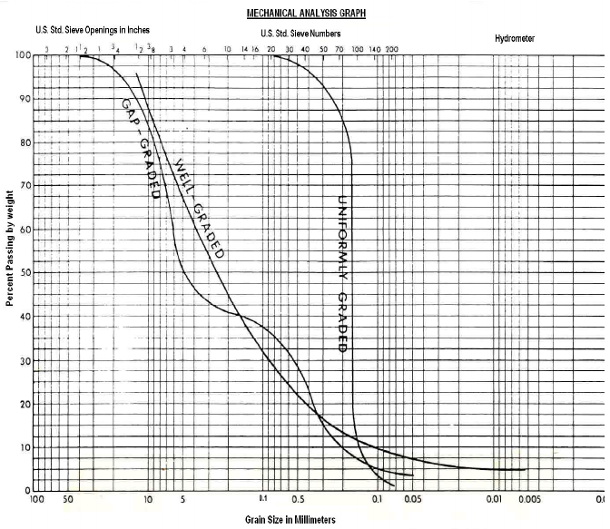
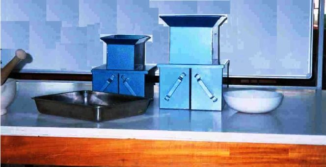
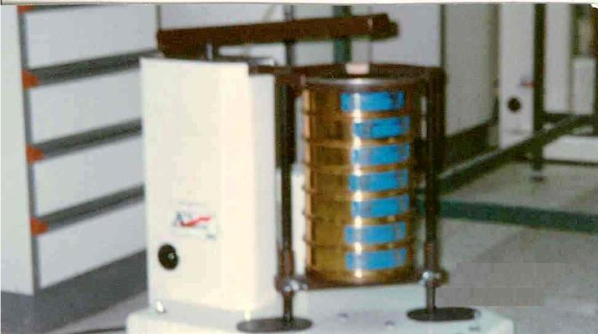
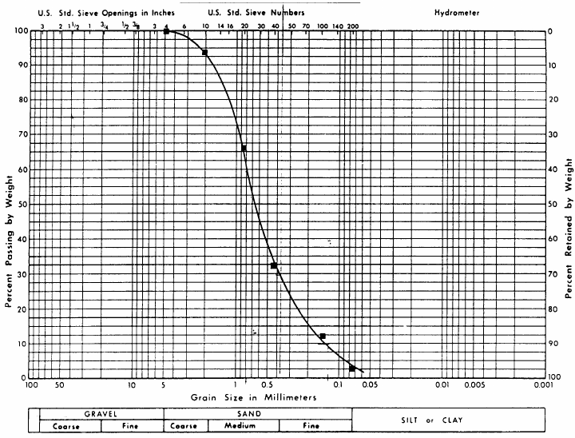

# Experiment 1: Grain Size Analysis — Mechanical Method

## Introduction

A knowledge of the sizes of the solid particles comprising a certain soil type and their relative proportion in the soil mass is often useful knowledge. Grain size distribution is used in soil classification, soil filter design, and used to predict in a general way how a soil may be expected to behave with respect to shear strength, settlement, and permeability.

## Objectives

- To conduct a mechanical particle-size analysis of a soil.

- To present the data in the form of a grain size distribution curve.

- To classify the soil.

## Theoretical Background

In the early days of soil mechanics, it was believed that the size of the individual soil particles and their relative distribution were the most important soil properties or characteristics. This has subsequently been shown not to be true, although such knowledge is still of considerable benefit. Grain size distribution is used in most engineering soil classification methods, and successful filter design is entirely dependent on this knowledge.

Two types of grain size analyses are typically accomplished: mechanical (or sieve) analysis and hydrometer analysis. Mechanical analysis determines the particle size and their relative distribution for those particles greater than 0.037mm. This is the size of opening in a U. S Bureau of standards No. 400 sieve; however, the U.S. No. 200 sieve (0.074 mm) is the smallest sieve size typically used in practice. The particle size equal to the No. 200 sieve opening is considered to be about the smallest individual particle that can be seen by the unaided human eye.

In addition to determining the particle sizes and the frequency of their occurrence, some conclusions can also be drawn with respect to the distribution of the particles or their (grading). A soil is said to be well graded or poorly graded, depending on the shape of the particle distribution curve. Two criteria must be applied in making this determination. The first criterion is the coefficient of curvature, Cc: Cc =D320/(D60×D10) The second criterion is the coefficient of uniformity, Cu: Cu =D60/D10 where,

D10 = grain diameter at 10% passing D30 = grain diameter at 20% passing D60 = grain diameter at 60 % passing

For a soil to be well graded, the following must be satisfied:

1 < Cc < 3 and

Cu > 4 (for gravel) Cu > 6 (for sands)

If the soil fails one, or both, of these criteria, it is considered to be poorly graded. Special cases of poorly graded soils are gap-graded and uniformly graded soils. Gap- graded soils can occur either as a result of two separate soils being mixed together (one soil having distinctly larger particle sizes than the other soil) or as a result of all of some range of intermediate particle sizes being removed from the soil. Uniformly graded soils consist almost entirely of particles having the same size. Both types of curves are illustrated in Figure 1.1.

Figure 1.1

## Specifications

The procedures of the test given below follow the ASTM D421 and D422. However, other specifications exist, namely ASSHTO T87 and T88 and U.S. Army corps of Engineers EM1110-2-1906, App. V, and B.S. 812 S103.

It should be noted that ASSHTO tests T87 & T88 are direct copies of ASTM D421& D422. The ASTM standards differ from that of U.S Army corps of Engineers standard in the method of drying of soil. ASTM and ASSHTO require air-dry soil while U.S. army corps of Engineers requires oven-dry soil. The ASTM also differs from B.S. in the size of sieves.

## Required Apparatus

1. A set of U.S. standard sieves (e.g. # 4, # 10, # 20, # 40, # 100, # 200), lid and pan (see Figure 1.2).

2. Set of sieve brushes for cleaning sieves.

3. Balance sensitive to 0.1 gm

4. Drying oven at 110 ± 5° constant temperature.

5. Large evaporating dish.

6. Mortar and rubber-tipped pestle.

7. Sample splitter or riffle for dividing samples.

8. Mechanical shaker.

## U.s. Standard Sieve

| Sieve Number | Opening (mm) |
|---|---|
| 4 | 4.76 |
| 6 | 3.36 |
| 10 | 2.00 |
| 20 | 0.84 |
| 30 | 0.59 |
| 40 | 0.42 |
| 50 | 0.297 |
| 60 | 0.25 |
| 80 | 0.177 |
| 100 | 0.149 |
| 120 | 0.125 |
| 140 | 0.105 |
| 170 | 0.088 |
| 200 | 0.074 |

(a)

(b)

(c)

Figure 1.2. (a) U.S. Sieves; (b) Sample Splitter; (c) Mechanical Shaker

## Required Measurements

1. Weight of each sieve.

2. Total weight of dry soil samples, Ws.

3. Weight of each sieve and retained soil.

4. Weight of oven dried soil passing No. 200 sieve.

## Procedure

1. Air dry the sample until it is thoroughly dry.

2. Clean and dry each sieve to be used. Weigh and record the weight of each sieve to the nearest 0.1 gm.

3. Carefully select a representative sample of the air dried soil and break the soil into its individual particles with the fingers or a rubber-tipped pestle. Be careful not to crush the particles. (Note: if the total sample is sufficiently large, select a representative sample either by using the method of quartering or by using sampler (sample splitter).

4. Weigh the sample to the same accuracy as in step 2 and record as Ws. Sieve the soil through a set of sieves by either using a mechanical shaker or by hand for at least 10 minutes.

5. Carefully separate the set of sieves and weigh and record each sieve with the soil retained on the same accuracy as in step 2.

6. Set aside the material passing the No. 200 sieve for use in the hydrometer analysis.

7. Place all material that did not pass the No. 200 sieve on the No. 200 sieve and wash thoroughly with distilled water. Catch all the rinse water and fines that are washed through the No. 200 sieve screen in a large, clean, evaporating dish of known and prerecorded weight.

8. Place the evaporating dish and its contents in the dry oven night at 110 ± 5°C. Remove from the oven and weigh. Record the weight of this additional material that was finer than No. 200 sieve. Re-Sieve that portion of the total sample that did not pass the No. 200 sieve.

## Calculations

1. Cumulative weight retained = summation of weight retained on this sieve and the upper sieves

2. Percent retained: Percent Retained = 100 ×(Wt. of soil retained on sieve)/(Total sample weight)

3. Percent passing (or percent finer than):

Percent passing = 100 − (cumulative percent retained)

## Presentation of Results

The result of a grain size analysis are carefully reported in the form of a grain size distribution curve similar to those shown in Figure 1.1. The grain size distribution curve is obtained by plotting the percentage finer by weight on the arithmetic scale as a function of the particle diameter on the logarithmic scale. The grain diameter in millimeter, designated by D, which corresponds to an equivalent percent finer on the grain size distribution curve is used to define a soil parameter by which the grain size distribution curve can be described.

The spread in the grain sizes of a given soil is measured by the coefficient of uniformity Cu, which is defined as: Cu =D60/D10 The shape of the grain size distribution curve between D60 and D10 grain sizes is defined by the coefficient of curvature Cc which is expressed as

Cc =D320/(D60×D10)

## Numerical Examples

A soil sample of 198.3 g total weight was placed in the top of a nest or sieve. The results of subsequent analysis are reported below and shown in Figure 1.3 and Table 1.1. Line 4 of the data sheet in Table 1.1 was calculated as follows:

Step 1 [Column 2]: The sieve was cleaned and weighed to the nearest 1.0 gm →

Sieve No. 40 weighed 367.

Step 2 [Column 3]: After sieving, the nest of sieves was disassembled and each sieve and its retained soil was weighed → sieve No. 40 and the soil retained on its mesh weighed 434.3 g.

Step 3 [Column 4]: Subtract the weight of the clean sieve from the step 2 weight.

Weight of soil retained on No. 40 sieve = 434.3 g − 367.0

(g = 67.3g).

Step 4 [Column 5]: The number represents the total weight of that would have been retained (failed to pass) on the No. 40 sieve if other sieves had not been in the nest above it.

Cumulative weight retained = (12.6 + 54.7) + 67.3 = 134.69

Step 5 [Column 6]: Cumulative % retained = 134.6/198.3×100 = 67.9% Step 6 [Column 7]: The percentage of the total sample that passed through the No.

40 sieve is the difference between the total sample and the % retained.

Percent Passing = 100 − 67.9 = 32.1%

Step 7 [Column 7]: Cu = 0.8/0.13 = 6.15

Cc = (0.38)2/(0.13 × 0.8) = 1.3

## Results Interpretations

Soil Classification:

Cu > 6 and 1 < Cc < 3 Our soil is well graded soil and % of fines = 2.4%

## Mechanical Analysis Graph

Figure 1.3

| Soil Mechanics Laboratory | SIEVE ANALYSIS |
|---|---|
| Civil Engineering Department | Data Sheet 1.1 |

Kuwait University  
Name: Numerical Example &emsp; Date: …………. &emsp; Group No. ………

Description of Soil: …………………………………………………………………….

| Weight of Sample |  |
|---|---|
| Weight of Dry Sample | 198.2 |

Table 1.1

| Sieve No. | Sieve diameter (mm) (1) | Sieve weight (g) (2) | Weight of sieve + soil (g) (3) | Weight of soil retained (g) (4) | Cumulative soil retained (g) (5) | Cumulative percent retained (6) | Percent passing (7) |
|---|---|---|---|---|---|---|---|
| 4 | 4.75 | 521.5 | 521.5 | 0 | 0 | 0.0 | 100.0 |
| 10 | 2 | 390 | 402.6 | 12.6 | 12.6 | 6.4 | 93.6 |
| 20 | 0.84 | 367.7 | 422.4 | 54.7 | 67.3 | 34.0 | 66.0 |
| 40 | 0.42 | 367 | 434.3 | 67.3 | 134.6 | 67.9 | 32.1 |
| 100 | 0.15 | 428 | 467.9 | 39.9 | 174.5 | 88.0 | 12.0 |
| 200 | 0.075 | 300.4 | 319.4 | 19 | 193.5 | 97.6 | 2.4 |
| Pan | -- | 355.9 | 360.6 | 4.7 | 198.2 | 100.0 | 0.0 |

Column (4) = Column (3) – Column (2)  
Column (5) = Column (4) + Column (5) of previous line  
Column (6) = 100 × [Column (5)/Weight]  
Column 7 = 100 – Column (6)

## References

ASTM D421 Standard Method for Dry Preparation of Soil for Particle Size Analysis of soil.

ASTM D422 Standard Method for Particle Size Analysis of soil.

AASHTO T-87 Standard Specification for Dry Preparations for Disturbed Soil Aggregate Samples for Test.

AASHTO T-88 Standard Method of Particle Size Analysis of Soil.

## Questions

1. What is meant by grain size distribution?

2. Draw sketches of different types of grain size distribution curves.

3. How can you classify the soil according to the Unified Soil Classification System?

4. How can you differentiate between a well graded and a poorly graded soil?

5. On what range of particle size does the sieve analysis apply.

6. Is it possible to carry out a sieve analysis on a sample of clay ?

Web Sites at the Internet:

• www.infratech.com/technical-comer/mmd/mmd-sieve-calc

• www.engin.swarthmore.edu/~rodger/food/e6/e61-lab2.html

• www.procurenet.com/csc/csc02.htm

• www.sccwrp.org/pubs/aarpt/art07.htm

| Soil Mechanics Laboratory | SIEVE ANALYSIS |
|---|---|
| Civil Engineering Department | Data Sheet 1.1 |

Kuwait University  
Name: Numerical Example &emsp; Date: …………. &emsp; Group No. ………

Description of Soil: …………………………………………………………………….

Weight of Sample  
Weight of Dry Sample

Table 1.1

| Sieve No. | Sieve diameter (mm) (1) | Sieve weight (g) (2) | Weight of sieve + soil (g) (3) | Weight of soil retained (g) (4) | Cumulative soil retained (g) (5) | Cumulative percent retained (6) | Percent passing (7) |
|---|---|---|---|---|---|---|---|
| 4 |  |  |  |  |  |  |  |
| 10 |  |  |  |  |  |  |  |
| 20 |  |  |  |  |  |  |  |
| 40 |  |  |  |  |  |  |  |
| 100 |  |  |  |  |  |  |  |
| 200 |  |  |  |  |  |  |  |
| Pan |  |  |  |  |  |  |  |

Column (4) = Column (3) – Column (2)  
Column (5) = Column (4) + Column (5) of previous line  
Column (6) = 100 × [Column (5)/Weight]  
Column 7 = 100 – Column (6)

| Soil Mechanics Laboratory | SIEVE ANALYSIS |
|---|---|
| Civil Engineering Department | Data Sheet 1.1 |

Kuwait University  
Name: Numerical Example &emsp; Date: …………. &emsp; Group No. ………

Description of Soil: …………………………………………………………………….

Weight of Sample  
Weight of Dry Sample

Table 1.1

| Sieve No. | Sieve diameter (mm) (1) | Sieve weight (g) (2) | Weight of sieve + soil (g) (3) | Weight of soil retained (g) (4) | Cumulative soil retained (g) (5) | Cumulative percent retained (6) | Percent passing (7) |
|---|---|---|---|---|---|---|---|
| 4 |  |  |  |  |  |  |  |
| 10 |  |  |  |  |  |  |  |
| 20 |  |  |  |  |  |  |  |
| 40 |  |  |  |  |  |  |  |
| 100 |  |  |  |  |  |  |  |
| 200 |  |  |  |  |  |  |  |
| Pan |  |  |  |  |  |  |  |

Column (4) = Column (3) – Column (2)  
Column (5) = Column (4) + Column (5) of previous line  
Column (6) = 100 × [Column (5)/Weight]  
Column 7 = 100 – Column (6)
