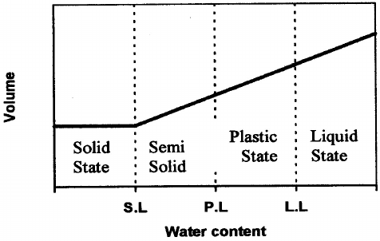
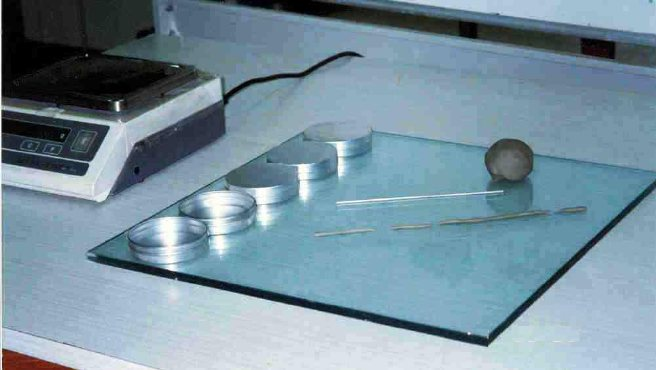
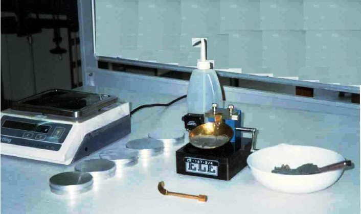
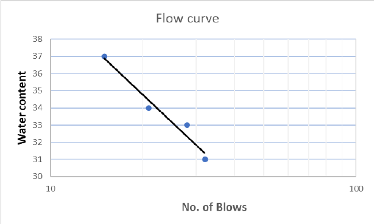
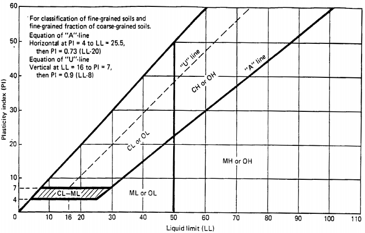
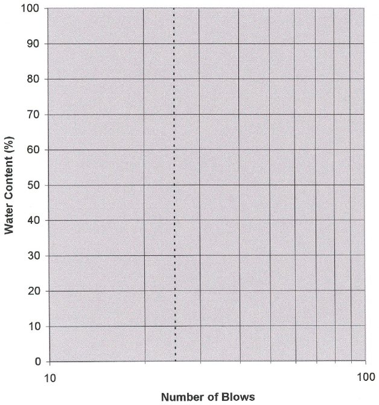

# Experiment 2: Atterberg Limits (Plastic and Liquid Limits)

## Introduction

Soil behavior is often related to the amount of water contained in the soil mass. Thus, knowledge of the range of moisture content over which a soil will exhibit a certain consistency is important in classifying a soil type, obtaining general information about a soil and its strength, compressibility, permeability and shrink-swell properties. It is also useful in predicting how a soil might perform when used as a construction material.

## Objectives

- To obtain the plastic limit and liquid limit of soil.

- To classify the soil.

## Theoretical Background

A fine-grained soil exists with its particles surrounded by water. The amount of water in the soil determines its consistency. The Liquid and Plastic limits are two of five limits proposed by A. Atterberg a Swedish soil scientist at the beginning of the twentieth century. However, A. Casagrande revised these limit proposed by Atterberg. He defined three limits: the shrinkage limit, the plastic limit, and the liquid limit (Figure 2.1). Each of these limits are defined as:

1. Shrinkage Limit: The moisture content at which no further volume change occurs with a further reduction in moisture content.

2. The Plastic Limit: The moisute content at which a thread of soil just begins to crack and crumble when rolled to a diameter of 3 mm (1/8 in).

3. The Liquid Limit: The moisture content at which a 2 mm wide groove in a soil will close for a distance 12 mm (1/2 in) when dropped 25 times, falling 1 cm each time at a rate of 2 drops per second in the standard liquid limit device.

Figure 2.1

## Specifications

Procedures of the liquid and plastic limit tests follow the ASTM D4312. Other specifications regarding the tests are AASHTO T89 and T990. The ASTM specifies the Casagrande grooving tool in liquid limit test while the AASHTO specifies a wedged shaped grooving tool.

The procedure of conducting the shrinkage limit test is not presented in this manual. If this limit is desired, the reader is referred to ASTM D427.

## Required Apparatus

1. Plastic Limit (Figure 2.2)

i) Large glass plate

ii) Rod of diameter 3 mm (1/8 in)

2. Liquid Limit (Figure 2.3)

i) Standard liquid limit device

ii) Grooving tool

3. General

i) Spatula

ii) Mixing dish iii) Moisture tins for moisture content determination iv) Balance, sensitive to 0.01 g

v) Dry oven at a constant 110 ± 5°C.

Figure 2.2. Typical Equipment Required to Perform Plastic Limit Test

Figure 2.3. Typical Equipment Required to Perform Liquid Limit Test

## Required Measurements

1. Plastic Limit

i) Moisture content, w

2. Liquid Limit

i) Moisture content, w

ii) Blow count, N

## Procedure

1. Sample Preparation:

The soil sample used should be a representative portion of air-dried soil that passes the No. 40 sieve. Sufficient distilled water is added to approximately 200 to 300 g of the selected soil sample, and is mixed thoroughly until a sticky uniform sample is formed. The mixture should be placed in an airtight container to prevent evaporation and left in a humid room to cure for a period of 24 hours.

2. Plastic Limit Test:

2.a) Select a small mass of the cured soil about 12 to 15 gm. Shape the soil into a ball.

2.b) Place the soil ball on the glass plate, and using the fingers in a palm-down position, begin to roll the ball to form a thread 3 mm in diameter. If the soil thread cracks, breaks or crumbles just as it reaches 3 mm in diameter, then the soil moisture content is at the plastic limit. Quickly, pick up the soil thread, break it up and place the broken pieces in the moisture tin. Weigh the covered moisture tin to the nearest 0.01 g. Remove the lid and place it in the oven for water content determination.

Repeat the test at least with three samples. The plastic limit is the average of the three tests provided that none of the tests deviate more than 5% from the average.

2.c) If during rolling the soil ball the soil thread does not crack or crumble when rolled to a diameter of 3 mm then its moisture content is higher than the plastic limit. To reduce its moisture content, knead the soil between the fingers or break the thread into several pierces, reshape it into a ball then start rolling again.

2.d) If the soil thread cracks and crumbles before its diameter reached 3 mm, then its moisture content is below that of the plastic limit. Moisten the fingers with distilled water, knead the soil and start rolling again.

3. Liquid Limit Test:

3.a) Place about 60 gm of moist cured soil specimen in the brass cup of the liquid limit device. Using the spatula, spread the soil across the bottom of the cup, making sure no lumps or air voids are created in the mixture. The surface of the soil should be smooth and have a thickness of approximately 1 cm.

3.b) Cut the soil with the grooving tool, such that a straight sharp cut is formed. The grooving tool should be held perpendicular to the cup at point of contact.

3.c) Lift and drop the cup by tuning the hand crank at a rate of 2 revolutions per second. Count the number of blows needed to close the two halves of the soil along the bottom of the groove a distance of 12 mm.

3.d) Using a dry clean spatula remove part of the soil forming the edge of the groove that flowed and place it in a small tin. Weigh the tin to nearest 0.01 g and place it in the oven for water content determination.

3.e) Remove the soil remaining in the cup to the mixing dish, add to it few drops of distilled water and mix it thoroughly. Repeat the above steps for three additional portions of the specimen for which the water content is increased. If four points have been obtained, two with blow counts greater than 25 and two with blow counts less than 25, the test is completed.

## Conclusions

Moisture content calculation:

Weight of water Ww = (wt. of tin + wet soil) − (wt. of tin + dry soil)

Weight of solids Ws = (wt. of tin + dry soil) – (wt of tin) Moisture content w = Ww/Ws×100

## Plastic Limit (pl)

The plastic limit is reported as a moisture content and it is calculated as above.

## Liquid Limit (ll)

The liquid limit is determined from a semi-logarithmic plot where the moisture content is represented versus the logarithm of the blow count for each trial. A straight line “curve of best fit” is drawn between the trial points as shown in Figure 2.4. The straight line is called the flow curve. Entering the flow curve at 25 blows, the corresponding moisture content is the liquid limit as indicated in Figure 2.4.

## Plasticity Index (pi)

The plasticity index is computed as follows:

## Pi = Ll – Pl

To determine the classification of the soil the results of the liquid limit and plasticity index are plotted on the plasticity chart, shown in Figure 2.5.

## Numerical Example

The plastic limit, liquid limit and plasticity index are determined for a silty clay.

Plastic Limit Determination

Table 2.1. Plastic Limit Determination

| Line No. |  | Trial No. 1 | Trial No. 2 |
|---|---|---|---|
| 1 | Tin number | 1 | 2 |
| 2 | Weight of tin (gm) | 33.1 | 30.9 |
| 3 | Weight of tin + Wet soil (gm) | 43.62 | 40.38 |
| 4 | Weight of tin + Dry soil (gm) | 41.94 | 38.82 |
| 5 | Weight of water, Ww (gm) (line 3 – line 4) | 1.68 | 1.56 |
| 6 | Weight of dry soil, Ws (gm) (line 4 – line 2) | 8.84 | 7.92 |
| 7 | Moisture content, w% (line 5 ÷ line 6) | 19% | 19.7% |

Plastic Limit = (∑w)/(No. of trials) = ((19% +19.7%))/2 = 19.4% Liquid Limit Determination

The soil moisture content corresponding to the four blow counts were determined in Table 2.2 and plotted as a function of the logarithm of the number of blows as in Figure 2.4.

Table 2.2. Liquid Limit Determination

| Line No. |  | Trial No. 1 | Trial No. 2 | Trial No. 3 | Trial No. 4 |
|---|---|---|---|---|---|
| 1 | Moisture tins number | 1 | 2 | 3 | 4 |
| 2 | Weight of tin (gm) | 29.86 | 31.50 | 32.01 | 30.51 |
| 3 | Weight of tin + Wet soil (gm) | 43.39 | 47.62 | 45.24 | 45.58 |
| 4 | Weight of tin + Dry soil (gm) | 40.18 | 43.61 | 41.87 | 41.50 |
| 5 | Weight of water, Ww (gm) (line 3 – line 4) | 3.21 | 4.01 | 3.37 | 4.08 |
| 6 | Weight of dry soil, Ws (gm) (line 4 – line 2) | 10.32 | 12.11 | 9.86 | 10.99 |
| 7 | Moisture content, w% (line 5 ÷ line 6) | 31.1% | 33.1% | 34.2% | 37.1% |
| 8 | Number of blows, N | 34 | 27 | 22 | 17 |

From Figure 2.4, the graph is entered at N = 25 to determine the liquid limit of the soil as 33.5% → 34%.

Plasticity Index = LL – PL

= 34% − 19.4% = 14.6%

Figure 2.5. Plasticity Chart

## References

ASTM D-4318 Standard Test Method for Liquid, Plastic, and Plasticity Index of Soil.

AASHTO T-89 Standard Methods of Determining the Liquid Limit of Soil.

AASHTO T-90 Standard Method of Determining the Plastic Limit and Plasticity Index of Soil.

Engineering Properties of Soils and their Measurements, 4th edition, Joseph E. Bowles, 1992, McGraw Hill, Inc.

Measuring Engineering Properties of Soil, Wray W.K., Prentice Hall, 1986.

## Questions

1. What is the purpose of the L.L and P.L test ?

2. How do you define P.L and L.L ?

3. Should you add or remove water to obtain a lower blow count ?

4. What is the minimum number of data points required to determine the P.L and L.L ?

5. Is there is a typical value for the L.L for clean fine sand ? Justify your answer.

Web Sites at the Internet:

• www.civil.port.ac.uk/projects/geotech/geol.html

| Soil Mechanics Laboratory | ATTERBERG LIMITS |
|---|---|
| Civil Engineering Department | Data Sheet 2.1 |

Kuwait University  
Name: ………………………….. &emsp; Date: …………. &emsp; Group No. ………

Description of Soil: …………………………………………………………………….

Plastic Limit Determination

| Test No. |  |  |  |  |  |
|---|---|---|---|---|---|
| Can No. |  |  |  |  |  |
| Wt. of wet soil + Can |  |  |  |  |  |
| Wt. of dry soil + Can |  |  |  |  |  |
| Wt. of can |  |  |  |  |  |
| Wt. of water = Ww |  |  |  |  |  |
| Wt. of dry soil = Ws |  |  |  |  |  |
| Water content = Ww/Ws |  |  |  |  |  |

Liquid Limit Determination

| Test No. |  |  |  |  |  |
|---|---|---|---|---|---|
| Can No. |  |  |  |  |  |
| Wt. of wet soil + Can |  |  |  |  |  |
| Wt. of dry soil + Can |  |  |  |  |  |
| Wt. of can |  |  |  |  |  |
| Wt. of water = Ww |  |  |  |  |  |
| Wt. of dry soil = Ws |  |  |  |  |  |
| Water content = Ww/Ws |  |  |  |  |  |
| Number of blows, N |  |  |  |  |  |

| Soil Mechanics Laboratory | ATTERBERG LIMITS |
|---|---|
| Civil Engineering Department | Data Sheet 2.2 |

Kuwait University  
Name: ………………………….. &emsp; Date: …………. &emsp; Group No. ………

Description of Soil: …………………………………………………………………….

