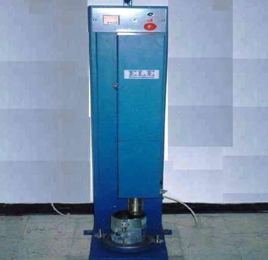
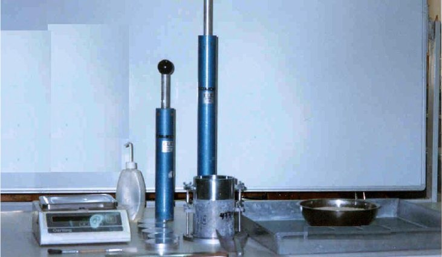
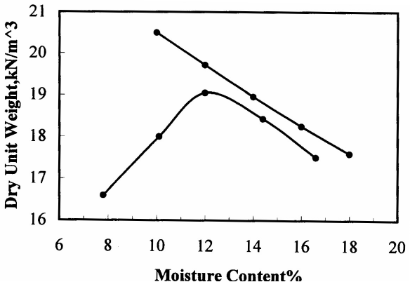

# Experiment 3: Moisture-Unit Weight Relationship — Compaction Test

## Introduction

Compaction is the mechanical process of increasing the unit weight of soil by removal of air and bringing soil particles closer. Increasing the unit weight of soil is often desirable for increasing shear strength, decreasing settlement, increasing bearing capacity and increasing stability of slopes.

## Objective

The purpose of the compaction test is to determine the moisture content at which maximum unit weight of the soil can be achieved. Two types of compaction test procedures are commonly used: Standard Compaction Test and Modified Compaction Test.

## Theoretical Background

When water is added to dry soil particles it is adsorbed on the surface and the particles are able to slide over one another more easily. As more water is added the voids between the particles begin to fill with water and increasing the density or unit weight of the soil. However, there is a point at which most of voids become filled with water, and because of the relative incompressibility of water, the soil density begins to reduce as more water is added. Thus, there is certain moisture content at which the amount of water is sufficient to rearrange the soil particles and fill most of voids. This moisture content is called the optimum moisture content.

## Specifications

The procedure of this test follows ASTM D698-91 for Standard Proctor and ASTM D1557-02 for Modified Proctor. Also AASHTO T99-90 for standard and AASHTO T 180-90 for modified.

## Required Apparatus

1. Compaction mold with plate and collar. The inside diameter of the mold is 10.16 cm (4 in) and its volume is 944 cm3 (1/30 ft3). The collar is 6.35 cm (2.5 in) high to permit for sample preparation.

2. Automatic Compactor Machine (Figure 3.1). The height of the rammer drop in the machine is adjustable from 30 cm to 45

cm. The weight of the rammer can be altered from 2.5 kg to 4.5 kg, to suit the test requirements (Figure 3.2).

3. Moisture tins.

4. Steel straight edge.

5. Mixing pan.

6. Sample extruder.

7. Trimming knife.

8. Drying oven to 110 ± 5°C.

9. Balance, sensitive to ± 0.01 gm.

10. Sieve No. 4.

Figure 3.1. Automatic Compactor Machine

Figure 3.2. Typical Equipment Required to Conduct both the

Standard and Modified Proctor test

## Required Measurements

1. Volume of compaction mold, Vm.

2. Weight of clean empty mold, Wm.

3. Weight of mold and compacted soil specimen, Wms.

4. Moisture content of soil specimen, w.

## Procedure

1. Select a representative quantity of air-dried soil that passes sieve # 4 (weighing approximately 14 kg).

2. Prepare at least four specimens by adding increasing amounts of water such that the moisture content for each specimen is approximately 2% greater than the preceding one. The specimens prepared must have moisture contents that with increasing moisture content, the specimen densities first increase and then decrease.

3. Weigh the clean, empty compaction mold to nearest gm and record Wm.

4. Attach the mold with the collar to the baseplate and place the mold in the compaction machine. Perform the test using either the standard or the modified method:

a) Standard test: Compact each specimen in three layers of approximately equal thickness. Each layer receives 25 blows of the 2.5 kg (5.5 lb) rammer, with drop height 30 cm.

b) Modified test: Compact each specimen in five layers of approximately equal thickness. Each layer receives 25 blows of the 4.5 kg (10 lb) rammer, with drop height 45 cm.

In either tests, the surface of each compacted layer should be scratched before placing the next layer. It should be noted also that the total height of compacted soil should extend above the top of the mold (not the collar) when compaction is completed by no more than 6.3 mm (0.25 in).

5. After compacting the last layer, remove the extension collar from the mold. Carefully trim the top of the compacted specimen with the steel straightedge so that it is leveled with the top of the mold.

6. Weigh the soil and mold to the nearest gm and record as Wms.

7. Remove the compacted soil from the mold by the extruder, and determine the average moisture content w.

a) Cut the specimen vertically through the center.

b) Take three samples from near the top, bottom and center of the sample. The moisture content is the average of the three samples.

8. Repeat steps 1 through 7 on specimens prepared with different water contents.

9. Plot unit weight versus moisture content as in Figure 3.3. The moisture content occurring at the greatest density is the optimum moisture content.

## Calculations

1. Wet unit weight of specimen, γ: γ =(Wms − Wm)/Vm

2. Dry unit weight of specimen, γdry: γdry =γ/(1 + w) where, w is the average moisture content.

3. To construct the zero air void by assuming soil is saturated for each water content,

γw γz = w + (1/Gs) where, Gs is specific gravity of soil, γw is unit weight of water, γz is the zero air voids dry unit weight.

## Presentation of Results

The results of compaction test is presented as a plot of dry density versus moisture. The plot shows the line of zero air voids (100% saturation). The optimum moisture content and maximum dry unit weight are stated.

## Numerical Example

A silty sand soil of specific gravity 2.65 was tested in the laboratory by the standard proctor test method to find its optimum moisture content and its maximum dry unit weight. A total of five specimens were prepared and tested. The test data are shown in the following tables. The results are presented in Figure 3.3.

Standard Proctor Test Volume of mold = 1000 cm3 &emsp; [GS = 2.65]

Table 3.1. Water Content Determination

| Sample number | 1 |  | 2 |  | 3 |  | 4 |  | 5 |  |
|---|---|---|---|---|---|---|---|---|---|---|
| Moisture can number | 1 | 2 | 3 | 4 | 5 | 6 | 7 | 8 | 9 | 10 |
| Wt. of can + wet soil (g) | 93.8 | 98.2 | 93.6 | 94.5 | 97.7 | 88.9 | 95.2 | 97.5 | 86.5 | 98.4 |
| Wt. of can + dry soil (g) | 88.6 | 92.7 | 87.4 | 88.1 | 89.0 | 80.4 | 85.5 | 87.7 | 75.4 | 85.6 |
| Wt. of water (g) | 5.2 | 5.5 | 6.2 | 6.4 | 8.7 | 8.5 | 9.7 | 9.8 | 11.1 | 12.8 |
| Wt. of can (g) | 22.6 | 22.0 | 22.0 | 21.3 | 17.8 | 17.8 | 17.3 | 18.5 | 17.2 | 17.3 |
| Wt. of dry soil (g) | 66.0 | 70.7 | 75.4 | 76.8 | 71.2 | 72.6 | 68.2 | 69.2 | 58.2 | 68.3 |
| Water content (%) | 7.87 | 7.78 | 8.22 | 8.33 | 12.1 | 11.7 | 14.2 | 14.2 | 19.1 | 18.7 |

Table 3.2. Dry Unit Weight Determination

| Average water content (%) | 7.83 | 8.3 | 11.9 | 14.2 | 18.9 |
|---|---|---|---|---|---|
| Weight of soil + mold (g) | 3757.2 | 3953.2 | 4109.0 | 4082.5 | 4015.2 |
| Weight of mold (g) | 1933.0 | 1933.0 | 1933.0 | 1933.0 | 1933.0 |
| Weight of soil in mold (g) | 1824.2 | 2020.2 | 2176.5 | 2149.5 | 2082.2 |
| Wet of unit weight kN/m3 | 17.89 | 19.83 | 21.34 | 21.08 | 20.42 |
| Dry unit weight kN/m3 | 16.59 | 18.31 | 19.07 | 18.45 | 17.17 |

Table 3.3. Zero-Air Void Determination

| Trial number | 1 | 2 | 3 | 4 | 5 |
|---|---|---|---|---|---|
| Water content (%) | 10 | 12 | 14 | 16 | 18 |
| Dry unit weight kN/m3 | 20.5 | 19.72 | 18.96 | 18.25 | 17.6 |

Optimum moisture content = 12.1% Maximum dry unit weight = 19.1 kN/m3

Figure 3.3. Moisture Content Versus Dry Unit Weight

## References

ASTM D698 Standard Test Method for Moisture-Density Relations of Soil-Aggregate Mixtures using 5.5 lb Rammer and 12 in Drop.

ASTM D1557 Standard Test Method for Moisture-Density Relations of Soil Aggregate Mixtures using 10 lb Rammer and 18 in Drop.

Engineering Properties of Soils and their Measurements, 4th edition, Joseph E. Bowles, McGraw Hill, Inc., 1992.

Measuring Engineering Properties of Soil, Wray W.K., Prentice Hill, 1986.

## Questions

1. How many data points are necessary to construct a compaction curve ?

2. Why is it important for the final level of compacted soil to be just above the mold body.

3. Will you obtain the same optimum water content and maximum density for the standard and modified compaction tests ? How would you expect the values to be different.

Web Sites at the Internet

• www.umeciv.maine.edu/cie366/moisture-density/default.htm

| Soil Mechanics Laboratory | COMPACTION TEST |
|---|---|
| Civil Engineering Department | Data Sheet 3.1 |

Kuwait University

| Name: ……………………………….. | Date: ………………………. | Group No.: ……………………… |
|---|---|---|
| Description of Soil: …………………. |  | Compaction type: ………………. |
| Mold No.: …………………………… | Weight of mold: …………… | Volume of mold: ……………….. |

| Dry Density Determination |  |  |  |  | Water Content Determination |  |  |  |  |  |  |  | Dry unit weight (gm/cm3) |
|---|---|---|---|---|---|---|---|---|---|---|---|---|---|
| Mold No. | Weight of mold (gm) | Weight of mold + soil (gm) | Weight of soil (gm) | Moist unit weight (gm/cm3) | Can no. | Weight of can | Weight of can + soil | Weight of can + dry soil | Weight of water (gm) | Weight of dry soil (gm) | Water content (%) | Avg. water content |  |
| 1 |  |  |  |  |  |  |  |  |  |  |  |  |  |
|  |  |  |  |  |  |  |  |  |  |  |  |  |  |
| 2 |  |  |  |  |  |  |  |  |  |  |  |  |  |
|  |  |  |  |  |  |  |  |  |  |  |  |  |  |
| 3 |  |  |  |  |  |  |  |  |  |  |  |  |  |
|  |  |  |  |  |  |  |  |  |  |  |  |  |  |
| 4 |  |  |  |  |  |  |  |  |  |  |  |  |  |
|  |  |  |  |  |  |  |  |  |  |  |  |  |  |
| 5 |  |  |  |  |  |  |  |  |  |  |  |  |  |
|  |  |  |  |  |  |  |  |  |  |  |  |  |  |
| 6 |  |  |  |  |  |  |  |  |  |  |  |  |  |
|  |  |  |  |  |  |  |  |  |  |  |  |  |  |
