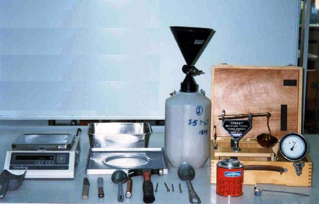
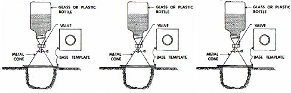

# Experiment 4: Field Density Measurement (Sand-Cone Method)

## Introduction

Field density refers to the volumetric weight of a soil in the field or its in- place unit weight. The methods typically available for making this determination are limited to shallow depths, usually 30 cm or less. The most common application of field-density determination is that of density testing during the construction of compacted earth fills, such as in dams or highway subgrades, to determine if adequate density and proper moisture content are being obtained.

## Objective

To determine the field density and the water content in field.

## Theoretical Background

There are three methods in common use of determining in-place field density: the sand cone method, the water balloon method and the nuclear density meter method. The sand-cone method is the oldest of the three methods. The principle of this method is to obtain a known mass of wet soil from a small excavation of irregular shape (a hole) in the ground. If the volume of the hole is determined, the wet density is simply computed as ρwet = (mass of soil)/(volume of hole). If the water content w of the excavated material is obtained, the dry density of the material is ρdry = ρwet/(1 + w). The water content could be determined in field using a special calcium carbide moisture- determining device, such as the Speedy Moisture Tester. It can also be determined in the field using a field oven.

The sand-cone method is used to find the volume of the hole. It is generally desirable to use a uniformly graded sand, such as Ottawa sand (sand passing the No. 20 sieve but retained on No. 30 sieve) to avoid segregation and non-uniform density problems. Since the density of this sand (ρ) is known, then the volume of the hole is computed as the mass of the material to fill the hole M, divided by the density of the sand, Vhole =M/ρ

## Specifications

The sand cone method follows the ASTM D1556-02 and AASHTO T191-86. The ASTM only requires that the sand used should have a Cu < 2 with a maximum particle size < 2.0 mm (No. 10 sieve) and less than 3% by weight passing the No. 60 (0.25 mm) sieve.

## Required Apparatus

1. Density apparatus, consisting of a jar with attached cone and base plate (Figure 4.1).

2. Clean, dry uniform sand of known density.

3. Balance.

4. Speedy Moisture Tester.

Figure 4.1. Sand-Cone Equipment: Sand-Cone, Plastic Jug of Sand, Hole Template,

Digging Tools, Speedy Moisture Tester, Balance

## Required Measurements

1. Calibration

a) Weight of empty apparatus, Wae

b) Weight of water filled apparatus, Waw

c) Temperature of water in apparatus, T

d) Weight of sand-cone apparatus, Was

e) Weight of sand-cone apparatus after filling cone, Wasf

2. Field Test

a) Weight of sand-cone apparatus before test, Was

b) Weight of sand-cone apparatus after test hole excavation, Wash

c) Weight of soil removed from test hole, W

d) Soil moisture content, w

## Procedure

1. Calibration To determine the volume of the jar and the cone,

a) Weigh the assembled apparatus while empty and record as Wae

b) Fill the apparatus with water and record as Waw

c) Find the weight of water in the jar Wwj and get volume of the jar, Vaj: Wwj = Waw – Wae

Vaj =Wwj/γw

d) Repeat the above steps two more times. Use the average of the three trials as the volume of the apparatus.

2. To determine the bulk density of the sand to be used in the field.

a) Place the dry, empty apparatus upright on a firm level surface, close the valve between the cone and the jar and fill the cone with sand.

b) Open the valve to fill the jar with sand, keeping the cone at least half full of sand. Close the valve and empty the excess sand. Weigh the apparatus with the sand and record as Was.

c) Determine the net weight of the sand: Ws = Was − Wae

d) Determine the bulk density of the sand: γb =Ws/Vaj.

3. To determine the weight of sand required to fill the cone:

a) Put sand in the apparatus and record the weight of the apparatus and the sand, Was.

b) Invert the apparatus on a clean, level, plane surface and open the valve. Keep the valve opened until the sand stops running out of the jar (Figure 4.2).

c) Close the valve. Weigh the apparatus with its remaining sand and record as Wasf.

d) Determine the weight of sand required to fill the cone as Wsf.

Wsf = Was – Wasf

4. To determine the weight of sand required to fill the cone as Wsf.

a) Prepare the surface of the location to be tested to that it is a level plane.

b) Place the base plate on the prepared plane surface. Dig the test hole inside the base plate opening. Place all the removed soil in a container with a tight-fitting lid or cover to avoid loss of soil moisture.

c) Place the inverted apparatus in the base plate opening and open the valve. Close the valve after sand has stopped to run out of the jar.

d) Weigh the apparatus and its remaining sand and record as Wash.

e) Weigh the wet soil that was removed from the hole and record to the nearest 1 g as W.

f) Determine the water content, w, of the soil using the Speedy Moisture Tester.

Figure 4.2. Schematic Representation of Sand-Cone Test Apparatus

## Calculations

1. Volume of the density apparatus jar, Vaj: Vaj =Wwj/ρw

where, Wwj = weight of water in the jar [procedure step 1].

2. Bulk density of sand, γb: γb =Ws/Vaj where, Ws is the net weight of sand required to fill the apparatus [procedure step 2].

3. Volume of test hole, V: V =(Was − Wash − Wsf)/Wb where, Was = weight of sand in the apparatus before the test [procedure step 3.a].

Wash = weight of sand in the apparatus after the test [procedure step 4.d].

Wsf = weight of sand in the cone [procedure step 3.d].

4. Dry density of soil, γd: γd =(W V)/(1+ w) where, w = water content of soil removed from the test hole.

W = weight of wet soil removed from the test hole.

## Presentation of Results

The results of the sand cone test usually consists of reporting the dry density and the soil moisture content. If the laboratory maximum dry density and optimum moisture content were determined, the field dry density should be reported as a percentage of the maximum laboratory dry density.

## Numerical Example

The density of the sand used in the jar (from calibration) ρb is 1.62 g/cm3.

| Mass of jar + cone before use | = 7394 g |
|---|---|
| Mass of jar + cone after use | = 2850 g |
| Mass of sand in cone | = 1898 g |

∴ Mass of sand used to fill hole + cone = 7394 – 285 = 4544 g Mass of sand in hole &emsp; = 4544 – 1898 = 2646 g

| ∴ Volume of hole | = 2646/1.62 = 1633 cm3 |
|---|---|
| Moisture content w% at field | = 12.9 % |
| Mass of moist soil from hole | = 2895 g |
| Wet density, γwet | = 2895/1633 = 1.773 g/cm3 |
| Dry density, γd | = γwet/1 + 0.129 = 1.57 g/cm3 |
| Dry unit weight γd | = 1.57 × 9.81 = 15.4 kN/m3 |

## References

ASTM D-1556-02 Standard Test Method for Density of Soil in Place by the Sand- Cone Method.

AASHTO T-191-86 Standard Test Method for Density of Soil in Place by the Sand- Cone Method.

Engineering Properties of Soils and their Measurements, 4th edition, Joseph E. Bowles, McGraw Hill, Inc., 1992.

Measuring Engineering Properties of Soil, Wray W.K., Prentice Hall, 1986.

## Questions

1. State the objective and principle of the sand cone method.

2. Would using different types of calibrated sand affect the field dry density result ?

3. What is the benefit of field density determination ?

4. Is it sufficient for quality control to determine the soil density in the field ?

5. Can you name two other test methods that are used to define soil density in the field.

| Soil Mechanics Laboratory | FIELD DENSITY |
|---|---|
| Civil Engineering Department | Data Sheet 4.1 |

Kuwait University  
Name: ……………….. &emsp; Date: ……… &emsp; Group No.: ……….

a) Sand Density Determination:

Type of Sand:  
Weight of Calibrated Mold:  
Volume of Calibrated Mold:

Weight of mold + sand:  
Trial # 1:  
Trial # 2:  
Trial # 3:

Average weight of mold + sand:  
Weight of sand:  
Density of sand:

b) Weight of Sand to Fill Cone and Template Groove:

|  | Trial # 1 | Trial # 2 | Trial # 3 |
|---|---|---|---|
| Wt. of filling jug after used |  |  |  |
| Wt. of filling jug before used |  |  |  |
| Wt. of sand used |  |  |  |

Average weight of sand used:

Field Data:

Weight of jug before used:  
Weight of jug after used:  
Weight of soil + can:  
Weight of can:  
Red of speedy moisture content:

Density of Soil:

Wet density:  
Dry density:

| Soil Mechanics Laboratory | FIELD DENSITY |
|---|---|
| Civil Engineering Department | Data Sheet 4.1 |

Kuwait University  
Name: ……………….. &emsp; Date: ……… &emsp; Group No.: ……….

a) Sand Density Determination:

Type of Sand:  
Weight of Calibrated Mold:  
Volume of Calibrated Mold:

Weight of mold + sand:  
Trial # 1:  
Trial # 2:  
Trial # 3:

Average weight of mold + sand:  
Weight of sand:  
Density of sand:

b) Weight of Sand to Fill Cone and Template Groove:

|  | Trial # 1 | Trial # 2 | Trial # 3 |
|---|---|---|---|
| Wt. of filling jug after used |  |  |  |
| Wt. of filling jug before used |  |  |  |
| Wt. of sand used |  |  |  |

Average weight of sand used:

Field Data:

Weight of jug before used:  
Weight of jug after used:  
Weight of soil + can:  
Weight of can:  
Red of speedy moisture content:

Density of Soil:

Wet density:  
Dry density:
