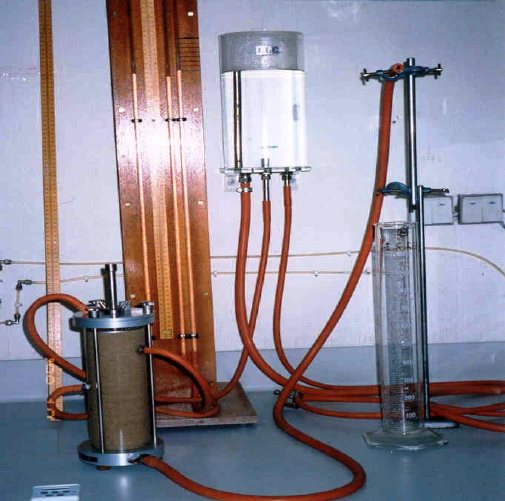
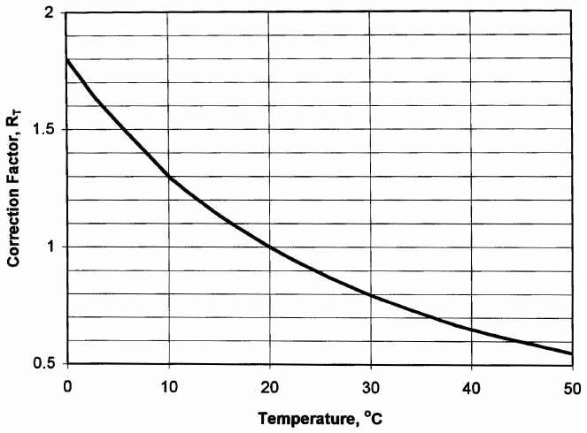

# Experiment 5: Permeability — a) Constant Head Method

## Introduction

The study of the flow of water through a porous soil media is often important in soil mechanics. The measure of the soil's ability to permit water to flow through its pores or voids is termed its permeability. Knowledge of the permeability properties of soil is necessary for several reasons. Some of those reasons include estimating the quantity of underground seepage under various hydraulic conditions, solving problems involving pumping seepage water from construction excavations, and for stability analysis of earth structures and retaining walls subjected to seepage forces.

## Objective

To determine the coefficient of permeability of a cohesionless (granular) soil.

## Theoretical Background

The coefficient of permeability is a constant of proportionally relating to the ease with which a fluid passes through a porous medium. Two general laboratory methods are available for determining the coefficient of permeability of a soil directly. These are the constant head method described here and the falling head method of test No. 7b. Both methods use Darcy's Law:

v = ki where, v : velocity of flow (typical units as cm/sec) k : coefficient of permeability (typical units is cm/sec) i : hydraulic gradient = H/L, dimensionless H : total head difference L : distance over which head changes (same units as H)

If the cross sectional area, A, through which flow is occurring is known, the flow rate, q, can be determined as:

q = kiA

If the time, t, over which flow occurs is also known, the total quantity of water, Q, flowing during this period can be found:

Q = kiAt

The device used to measure soil permeability is called a permeameter. The permeameter used in conducting the constant head test is shown in Figure 5.1. It is connected to a reservoir that maintains a constant head supply. Then by measuring the length of the specimen L through which flow occurs, the diameter of the permeameter (to obtain the cross-sectional area, A), the difference in piezometer readings H and the amount of water, Q, that flows through the soil specimen in a known time, t, the coefficient of permeability can be found as:

k = QL/HAt

## Required Apparatus

1. Permeameter cylinder: A transparent plastic cylinder similar to that shown in Figure 5.1. Two piezometers are connected to the side of the cylinder within limits to be occupied by the soil sample.

2. Perforated metal or plastic disks and circular wire screens.

3. A device for maintaining a constant-head water supply.

4. Timing device (stop watch).

5. Graduated cylinder, 100 ml capacity.

6. Centigrade thermometer, range 0 to 50°C.

7. Balance, sensitive to 0.1 g.

8. Oven.

9. Scale, graduated in centimeters.

## Required Measurements

1. Wet weight of soil specimen, Wwet.

2. Moisture content of soil specimen, w.

3. Diameter of soil specimen, D.

4. Length of soil specimen, L.

5. Reading of first piezometer, H1.

6. Reading of second piezometer, H2.

7. Elapsed time of test, t.

8. Weight of beaker and captured water, Wbw.

9. Temperature of test water, T.

Figure 5.1. Laboratory Apparatus for Constant Head Test

## Placement and Saturation of Specimen

1. Oven dry enough representative material and record its weight, Ws, to nearest

0.1 g on the data sheet.

2. Place a wire screen, with openings small enough to retain the specimen, over a perforated disk near the bottom of the permeameter above the inlet.

3. Allow deaired water to enter the water inlet of the permeameter to a height of about 10 mm above the bottom of the screen to prevent forming air bubbles. Mix the soil thoroughly and place in the permeameter, keeping the water level 10 mm above the soil during placement to avoid segregation.

4. The placement procedure outlined above will result in a loose specimen. To produce a higher density, the sides of the permeameter can be tapped uniformly along its circumference with a rubber hammer to the desired height of the specimen. Another procedure is to place the dry soil in layers in the permeameter and compact the soil to the desired density.

5. Determine the weight of the material placed in the permeameter from the weight of the original and the excess material.

6. Level the top of the specimen, cover with a wire screen similar to that used at the base, and fill the remainder of the permeameter with a filter material.

7. Measure the length of the specimen and inside diameter of the permeameter to the nearest 0.1 cm and record on the data sheet.

## Procedure

1. Determine the wet weight of the soil in the permeameter to the nearest 0.01 g and record as W wet. Also determine the moisture content and record as w.

2. Measure the inside diameter of the permeameter and record as D.

3. Measure the length of the soil specimen and record as L.

4. Weigh the clean, dry beaker to the nearest 0.1 gm. and record this weight as Wb.

5. Place the specimen in the permeameter and start water flowing through the sample. This pre-measurement flow period should last at least 10 minutes, but preferably longer to ensure that the sample is saturated. Bubbles that appear

(entrapped air) should be removed by taping gently on the permeameter or using other means that will not alter the sample to be tested. Flow should be continued until constant flow is achieved from the constant head chamber.

6. When constant flow conditions have been achieved, record the piezometers readings.

7. At some convenient time, place the beaker beneath the outflow from the constant head chamber and catch the outflow in the beaker. Start the stopwatch simultaneously.

8. After a reasonable quantity of water has been caught in the beaker (the larger the quantity of water, the less chance for error), remove the beaker and stop the stopwatch. Record the elapsed time as t. Measure and record the temperature of the test water as T.

9. Dry the outside of the beaker and weigh to the nearest 0.01 g. Record this weight as Wbw.

## Calculations

1. Calculate the quantity of flow, Q

Q = Wbw – Wb

2. Calculate the head, H

H = H1 – H2

3. Calculate the cross-sectional area, A A = π/4 D2

4. Calculate the coefficient of permeability, K, at test temperature T KT =(Q ×L)/(H ×A × t)

5. Correct for the temperature effect on viscosity K20 = KT ×RT/R20 where RT is the correction factor for viscosity of water (Figure 5.2).

6. Calculate void ratio: Since γd or γwet and S are known, and if Gs is known or can be estimated, the phase diagram can be solved and e determined. Since the soil is saturated, it can also be shown that e can be found from e =(Gs γw)/γd − 1

Figure 5.2. Correction Factor, RT, for Viscosity of Water

## Presentation of Results

The results of a permeability test are usually reported in a scientific notation with a statement as to whether or not the coefficient of permeability value being reported is corrected to the standard 20°C. The method of testing is also reported.

## Numerical Example

Table 5.1. Typical Measurements from a Constant Head Permeability Test

|  | Test No. |  |
|---|---|---|
|  | 1 | 2 |
| Height of specimen (cm) | 14 | 14 |
| Readings of upper pizometer H1 | 130 | 130 |
| Readings of lower pizometer H2 | 82 | 82 |
| Head loss (cm) | 48 | 48 |
| Outflow + tare | 825 | 800 |
| Tare weight | 750 | 725 |
| Quantity of flow, Q (gm) | 75 | 75 |
| Elapsed time, t (sec) | 120 | 120 |
| Water temperature, C° | 15 | 15 |
| RT | 1.1 | 1.1 |
| Distance between piezometers, L′ | 14 | 14 |

KT =QL/HAt=((75 g) (1 cm3/ g) (14 cm))/((48 cm) (81.07) (120)) where, KT = 2.25 × 10-3 cm/sec

K20 = KT × RT = 2.25 × 1.1 = 2.475 × 10-3 cm/sec e =(VGs γw)/Ws− 1 =((957.52) (2.66) (1))/((1756.81)/ (1 + 0.0372))− 1 = 1.5 − 1 = 0.5

## Possible Sources of Errors

Some of the errors which may cause inaccurate determinations of the coefficient of permeability are:

1. Non-uniform compaction of cohesionless soil, specially when there is an accumulation of fines on each compacted layer.

2. Incomplete initial saturation of the specimen.

3. Excessive hydraulic gradient that might cause the flow not to be laminar.

4. The presence of fine bubbles in the system.

5. Leakage along the circumference of the specimen in the permeameter.

## References

ASTM D-2434 Standard Test Method for Permeability of Granular Soils (Constant Head).

AASHTO T-215 Standard Test Method for Permeability of Granular Soils.

Engineering Properties of Soils and their Measurements, 4th edition, Joseph E. Bowles, McGraw Hill, Inc., 1992.

Measuring Engineering Properties of Soil, Wray W.K., Prentice Hall, 1986.

## Questions

1. What are the factors that affect the magnitude of the coefficient of permeability K in granular soil ?

2. Does the amount of fines affect the permeability ? explain.

| Soil Mechanics Laboratory | PERMEABILITY |
|---|---|
| Civil Engineering Department | Constant Head Method |
| Kuwait University | Data Sheet 5.1 |
| Name: ……………….. Date: …………… | Group No.: …………….. |

Description of Soil: ……………………………

Void Ratio Determination

| Wt. of dry soil + can |  | Diameter of specimen, D |  |
|---|---|---|---|
| Wt. of can |  | Area of specimen, A |  |
| Wt. of dry soil Ws |  | Initial height of specimen, L |  |
| Sp. Gravity, Gs |  | Initial volume of specimen, V |  |
| Vol. of solid (Vs = Ws/Gs) |  | Initial void ratio, e |  |

Coefficient of Permeability

| Test No. |  |  |  |  |
|---|---|---|---|---|
| Initial height of specimen |  |  |  |  |
| Void ratio, e = (AL – Vs)/Vs |  |  |  |  |
| Red. lower piezometer, h1 |  |  |  |  |
| Red. upper piezometer, h2 |  |  |  |  |
| Head loss, h |  |  |  |  |
| Quantity of flow, Q |  |  |  |  |
| Elapsed time, t |  |  |  |  |
| Water temperature, °C |  |  |  |  |
| Viscosity correction factor, RT |  |  |  |  |
| Distance between piezometers, LT |  |  |  |  |
| Coefficient of permeability, K20 |  |  |  |  |
