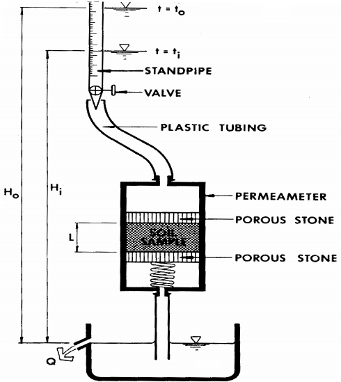

# Experiment 5: Permeability — b) Falling Head Method

## Introduction

This test is conducted in the same manner as the constant head test, except that the head of water is not maintained constant, but is permitted to fall within the upper part of a standpipe directly connected to the specimen. The quantity of water flowing through the specimen is determined indirectly by computation. The falling head test is generally used for fine sand, silts or clays.

## Objective

To determine the coefficient of permeability of fine sand, silts or clays.

## Theoretical Background

The theoretical background of the constant head test discussed earlier is also applicable to this test. A sketch of the apparatus used for conducting the falling head permeability test is shown in Figure 5.3. The falling head device consists of a stand pipe from which water is permitted to flow downward in to the soil specimen. The same dimensions of specimen length and diameter are required in the falling head test as they are in the constant head test. The period of flow is also required in both tests. The principal difference between the tests is that the hydraulic gradient, i, is always changing as the falling test progresses.

## Required Apparatus

1. Permeameter cylinder: A transparent plastic cylinder similar to that shown in Figure 5.3. The size of the standpipe to be used in the test should be large enough not to cause significant capillary rise in the standpipe. In order to accelerate testing, air pressure may be applied to the standpipe to increase the hydraulic gradient.

2. Perforated metal or plastic disks and circular wire screens about 100 mesh, cut for a close fit inside the permeameter.

3. Filter materials such as Ottawa sand, coarse sand and the gravel of various gradations.

4. Deaired water.

5. Timer (stop watch).

6. Centigrade thermometer, range 0 to 50°C.

7. Balance, sensitive to 0.1 g.

8. Oven.

9. Scale, graduated in centimeter.

Figure 5.3. Schematic Representation of the Apparatus Required for the

Falling Head Permeability Test

## Required Measurements

1. Wet weight of soil specimen, Wwet.

2. Moisture content of soil specimen, w.

3. Diameter of soil specimen, D.

4. Length of soil specimen, L.

5. Cross-sectional area of standpipe, a.

6. Height to water surface in standpipe at start of test, H0.

7. Height to water surface in standpipe at end of test, H1.

8. Time at start of test, t0.

9. Time at end of test, t1.

10. Temperature of test water, T.

## Placement and Saturation of Specimen

The same procedure of placement and saturation of specimen used in the constant head permeability test will be used for the falling head permeability test. All relevant data should be recorded on the data sheet, Table 5.2.

## Procedure

1. Measure and record on the data sheet the height of the specimen, L, and the cross-sectional area of the specimen, A.

2. With the valve closed, raise the head of water in the standpipe above the discharge level of the permeameter. The difference in head should not result in an excessively high hydraulic gradient during the test.

3. Begin the test by opening the valve and start the timer. As the water flows through the specimen, measure and record the height of water in the standpipe above the discharge level, h0, in centimeters, at time t0, and the height of water above the discharge level, ht, in centimeters, at time tf.

4. Observe and record the temperature of the water in the permeameter.

5. Report the determination of permeability, and if the computed values differ by a appreciable amount, repeat the test until consistent values of permeability are obtained.

## Calculations

1. Compute the void ratio of the soil.

2. Compute the coefficient of permeability K20, using the following equation: K20 = RT ×aL/Atℓnh0/hf where, a : inside area of standpipe, sq.cm. A : cross-sectional area of the specimen, sq.cm. L : length of specimen, cm. T : elapsed time (tf – t0), sec. h0 : height of water in standpipe above discharge level at time t0, cm. hf : height of water in standpipe above discharge level at time tf, cm. RT : temperature correction factor for viscosity of water obtained from Figure 5.2.

## Presentation of Results

The results of a permeability test are usually reported in scientific notation with a statement as to whether or not the coefficient of permeability value being reported in corrected to the standard 20°C.

## Numerical Example

Table 5.2. Typical Measurements from a Falling Head Test

|  | Test No. |  |
|---|---|---|
|  | 1 | 2 |
| Time, t1 | 1735 |  |
| Time, t0 | 1545 |  |
| Elapsed time, t1 – t0 (sec) | 93 |  |
| Initial head, H0 (cm) | 63.7 |  |
| Final head, H1 (cm) | 48.1 |  |
| Area of stand pipe, a (cm2) | 0.865 |  |
| Water temperature, T (C°) | 23 |  |
| Viscosity correction factor, RT | 0.94 |  |

KT =aL/Atℓnh0/hf KT =(0.865 × 1.852)/(31.61 × 93000)ℓn63.7/48.1 = 1.53 × 10-7 cm/sec K20 = KT × RT = 1.53 × 10-7 × 0.94 = 1.44 × 10-7 cm/sec e =(V Gs γw)/Ws − 1 e =(58.64 × 2.81 × 1)/(116.5 (1 + 0.258))− 1 = 0.78

Table 5.2. Typical Measurements from a Falling Head Test

|  | Test No. |  |
|---|---|---|
|  | 1 | 2 |
| Time, t1 |  |  |
| Time, t0 |  |  |
| Elapsed time, t1 – t0 (sec) |  |  |
| Initial head, H0 (cm) |  |  |
| Final head, H1 (cm) |  |  |
| Area of stand pipe, a (cm2) |  |  |
| Water temperature, T (C°) |  |  |
| Viscosity correction factor, RT |  |  |

## References

Measuring Engineering Properties of Soil, Wray W.K., Prentice Hall, 1986.

Engineering Properties of Soils and their Measurements, 4th edition, Joseph E. Bowles, McGraw-Hill, Inc., 1992.

Measuring Engineering Properties of Soil, Wray W.K., Prentice Hall, 1986.

## Questions

1. Define the total head in terms of water pressure, elevation, and unit weight of water.

2. Define soil permeability. What are the dimensions and units of permeability ?

3. Does the permeability increase or decrease with temperature.

4. What is the critical hydraulic gradient ?

5. Derive the expression for permeability in a constant head test.

6. Derive the expression for permeability for a falling head test.

| Soil Mechanics Laboratory | PERMEABILITY |
|---|---|
| Civil Engineering Department | Falling Head Method |
| Kuwait University | Data Sheet 5.2 |
| Name: ……………….. Date: …………… | Group No.: …………….. |

Description of Soil: ……………………………

Void Ratio Determination

| Wt. of dry soil + can |  | Diameter of specimen, D |  |
|---|---|---|---|
| Wt. of can |  | Area of specimen, A |  |
| Wt. of dry soil Ws |  | Initial height of specimen, L |  |
| Sp. Gravity, Gs |  | Initial volume of specimen, V |  |
| Vol. of solid (Vs = Ws/Gs) |  | Initial void ratio, e |  |

Coefficient of Permeability

| Test No. |  |  |  |  |
|---|---|---|---|---|
| Initial height of specimen |  |  |  |  |
| Void ratio, e = (AL – Vs)/Vs |  |  |  |  |
| Initial time, t1 |  |  |  |  |
| Final time, t2 |  |  |  |  |
| Elapsed time, t = t1 – t2 |  |  |  |  |
| Initial head, h1 |  |  |  |  |
| Final head, h2 |  |  |  |  |
| Area of standpipe, a |  |  |  |  |
| Water temperature, °C |  |  |  |  |
| Viscosity correction factor, RT |  |  |  |  |
| Coefficient of permeability, K20 |  |  |  |  |
