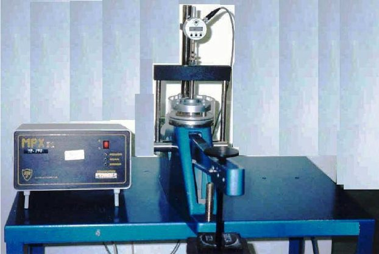
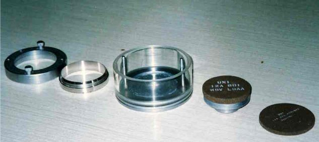
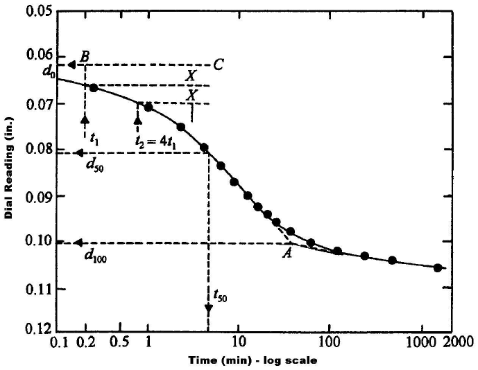
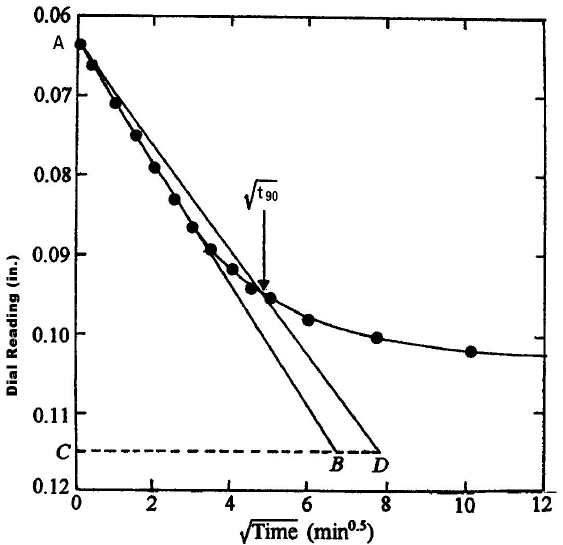
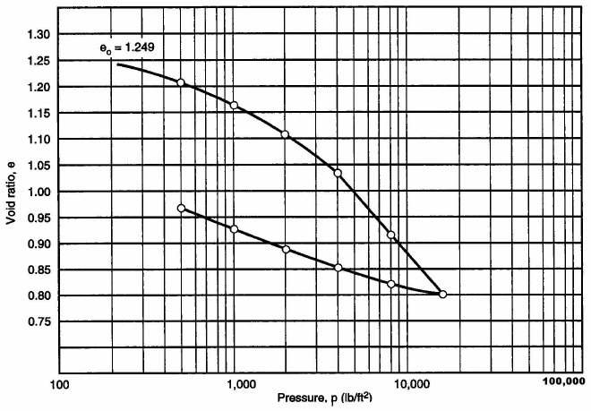
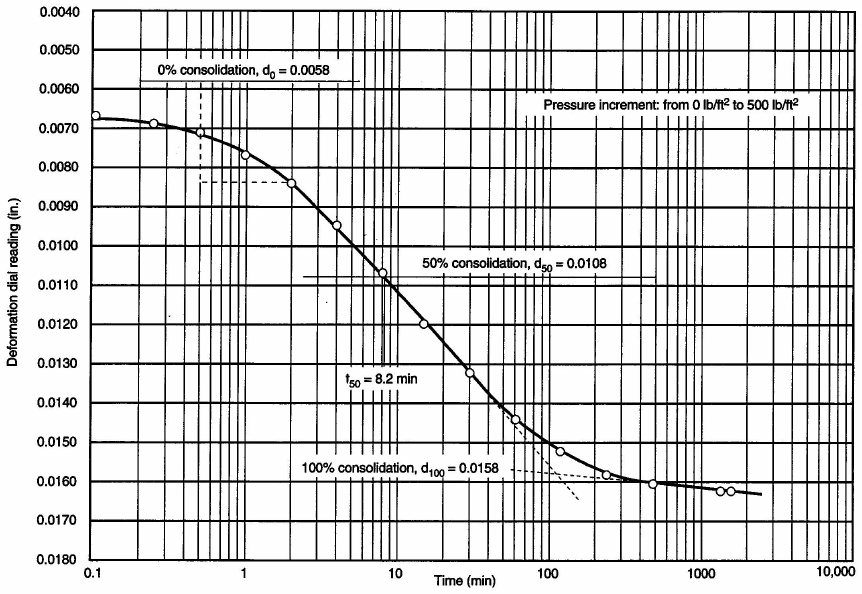
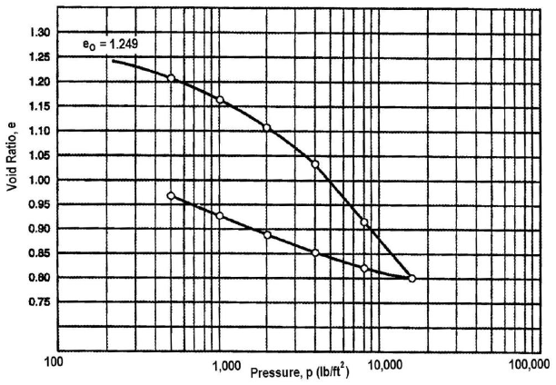

# Experiment 6: Consolidation

## Introduction

When a new structure is constructed, the stress in the soil mass supporting the structure is changed. If this change in stress increases the pressure on the soil, the soil will settle beneath the applied load. If the change in soil stress results in a decrease in a soil pressure, such as when soil is removed in an excavation, soil may exhibit the opposite effect (i.e., heave). The amount of volume change that occur in the soil is often one of the governing design criteria of a project. Thus, it is important to estimate the amount of soil compression or consolidation.

## Objectives

• To conduct the consolidation test. • &emsp; To determine the compression index Cc which is used to estimate the total amount of primary consolidation settlement expected to occur in a soil strata.

• To determine the coefficient of consolidation Cv which is used to estimate the time rate of consolidation.

## Theoretical Background

When an additional stress (Δσ) is applied to a saturated soil specimen, the entire stress is immediately (at t = 0) carried by the pore water as excess pore pressure (Δσ = Δu). When some time (t = t0) elapses, some of the excess pore pressure is dissipated and the effective stress increases by a similar amount. As more time elapses, an additional amount of the excess pore pressure is dissipated and more of (Δσ) is transferred to the soil solids as an increase in effective stress. Finally, after a very long time (t = ∞), the increase in stress (Δσ) is completely transferred to the soil skeleton as effective stress. This leads to the reduction in the void ratio and a reduction in the sample thickness. This reduction is termed consolidation.

## Required Apparatus

1. Consolidometer: consisting of rigid plate, ring, porous stones loading plate and support for dial gage (Figure 6.1, 6.2).

Figure 6.1. Consolidation Apparatus

Figure 6.2. Consolidation Ring and Porous Stone

2. Loading device.

3. Soil trimming device.

4. Balance sensitive to 0.01 gm.

5. Timer.

6. Moisture content tins.

7. Dial gage (reading to nearest 0.01 mm).

8. Evaporating dish.

## Required Measurements

1. Initial moisture content, wi

2. Initial wet weight of soil Wsi

3. Initial specimen thickness, H0

4. Specific gravity, Gs

5. Specimen thickness at specified times for each specified loading increment, Hi

6. Specimen thickness at end of test, Hf

7. Weight of soil solids, Ws

8. Final moisture content, wf

## Specimen Preparation

Before preparing the specimen, the porous stones should be placed in distilled water for several minutes to ensure that the stones are saturated and will not draw water from the specimen. The procedure for inserting the sample into the consolidometer differs if a remolded specimen or an undisturbed specimen is to be tested. If testing an undisturbed specimen, the specimen should be carefully trimmed to the same diameter as the consolidometer ring. The prepared specimen is inserted into the ring making sure that it flushes with both the top and the bottom of the consolidometer ring. If a remolded specimen is to be tested, soil at the proper moisture content is placed in the consolidometer ring using a spatula avoiding lumps and voids. The soil and the consolidometer ring is weighed to the nearest 0.01 g and recorded as Wsi.

Filter paper should be inserted between each porous stone and the soil specimen to prevent intrusion of the soil into the porous stone. The initial moisture content should be determined and recorded as wi.

## Procedure

1. Assemble the consolidometer and place it on the loading device (Figure 6.1). Place the loading cap on the porous stone.

2. Fill the grooves in the base of the consolidometer with water.

3. Install the dial gage and record the dial reading corresponding to zero load dz.

4. Apply a load increment and record the dial reading at 0.1, 0.25, 0.5, 1,2, 4, 8, 15 and 30 minutes and 1, 2, 4, 8 and 24 hour.

5. Increase the loading increment by approximately doubling the previous applied pressure each time until the desired pressure is obtained. Usually the loading sequence consists of 20, 40, 80, 160 and 320 kPa. The dial reading versus time is recorded for the load increment.

6. If unloading characteristics are to be measured, the specimen should be unloaded in the same order in which it was loaded taking readings in accordance with step 4.

7. When dial readings indicate no further significant rebound, remove the dial indicator and disassemble the apparatus and determine the water content of the specimen.

## Presentation of Results

Two graphical fitting methods are used to present the dial reading versus time, namely the logarithm-of-time fitting method and square-root-of time method.

## Logarithm-of-time Method

The logarithm-of-time method is applied by plotting the dial reading on the vertical axis and the logarithm of the corresponding elapsed time as the abscissa. A typical dial reading versus long-time curve is shown in Figure 6.3. The data taken during any loading increment represents two types of compression. The first type is called primary consolidation. However, even after the excess pore water pressure has been dissipated, a small amount of additional compression will occur. This additional compression is termed secondary consolidation and is believed to be a continuing soil-particle readjustment under constant effective stress. The point of division between primary and secondary consolidation is determined graphically as follows:

1. Extend the straight-line portion of the curve defined by the 8, 16 and 24 hour data points back toward the vertical axis.

2. Extend downward the straight-line portion of the center of the reverse S- shaped curve until it intersects to straight-line extension of step 1.

3. The intersection of the two straight-line extensions is considered to be the division between primary and secondary consolidation. The dial reading corresponding to this point of intersection is termed d100 i.e., 100% consolidation and the corresponding time is termed t100.

When a new pressure is applied there is usually a larger initial compression attributed to the compression of entrapped air. To determine graphically the dial reading at the time the new pressure is applied the following steps are undertaken:

1. Select one of the initial data points (e.g., at 0.25, 0.5 or 1 min.) and call it t1.

2. Multiply t1 by 4 to obtain t2.

3. The difference in dial readings corresponding to t1 and t2 is y.

4. The point d0 is found by laying off a distance y above t1 data point.

The dial gage reading corresponding to 50% consolidation is obtained as d50 = (d0+d100)/2.

Figure 6.3. Dial Reading versus Logarithm of Time

## Square-root-of-time Method

In the square-root-of-time method, the dial reading is plotted as the ordinate and the square root of the elapsed time as the abscissa (Figure 6.4).

1. The zero point, d0, is obtained by extending the straight-line portion of the curve upward until it intersects the vertical axis (zero time).

2. The point of 90% consolidation is obtained by drawing another straight line through d0 that has an inverse slope of 1.15 times that line obtained in step 1.

3. The point where the line obtained in step 2 intersects the curve is defined as the point of 90% consolidation d90. To obtain d100: d100 = d0 −10/9(d0 − d90)

Figure 6.4. Dial Reading versus Square Root of Time

COEFFICIENT OF CONSOLIDATION Cv

The coefficient of consolidation Cv is determined using the time at 50% primary consolidation t50 (obtained from logarithm-of-time vs. dial reading curve) or using time at 90% primary consolidation t90 (obtained from square-root-of-time vs. dial reading curve).

| 2 | 2 |
|---|---|
| (H/n) | (H/n) |

Cv =T/t50 or Cv =T/t90 where, T = time factor = 0.197 for 50% consolidation = 0.848 for 90% consolidation

H = average length of largest drainage path during the given loading increment.

t50 = time elapsed corresponding to d50 t90 = time elapsed corresponding to d90 n = number of drainage path = 1 (when one porous stone is used) = 2 (when two porous stones are used).

## Void Ratio–log Pressure Curve

The void ratio-log pressure (e-log P) curve is obtained by plotting the void ratio corresponding to the last dial reading of the load increment as the ordinate, against the logarithm of the total applied pressure as the abscissa (Figure 6.5).

e-log p curve

Figure 6.5. e-log p curve

The compression index, Cc, is found as the slope of the straight-line portion of the e- versus log-P curve, and is given as:

Cc =(e1 − e2)/(log P2 − log P1)=(e1 − e2)/(log (P2/P1)) where, P1 and P2 are selected pressure from the straight line portion of the curve and e1 and e2 are the corresponding void ratios.

The swell index, Cs is found as the slope of the straight line portion of the rebound curve for the unloading stage.

## Calculations

1. Specimen height at end of each loading increment

Hi = H0 – (dfi – dz) where, H0 = original specimen height dfi = dial reading at end of each load increment.

2. Height of solids Hs =Ws/(Gs γw A) where, A = area of specimen

Gs = specific gravity of solids γw = unit weight of water

3. Void ratio before test e0 e0 =(H0 − Hs)/Hs

4. Void ratio at end of test ef ef =(Hf − Hs)/Hs

where, Hf = height of specimen at end of test

Hf = H0 − ΔH where, ΔH is the net change in height of specimen.

## Numerical Example

A consolidation test was performed in the laboratory, and the following data were obtained:

A. Specimen Data

At beginning of test:

Diameter of specimen, D = 2.50 in. Initial height of specimen, H0 = 0.780 (i.e., 1.981 cm) Mass of specimen ring plus specimen = 208.48 g Mass of specimen ring = 100.50 g Specific gravity of soil = 2.72

At end of test:

Mass of entire wet specimen plus can = 234.54 g Mass of entire dry specimen plus can = 203.11 g Mass of can = 127.17 g

B. Time-versus-Deformation Data

Load increment from 0 to 500 lb/ft2

The time-versus-deformation data given in the following table are for a loading increment from 0 to 500 Ib/ft2. It would, of course, be necessary to have additional sets of time-versus-deformation data for a number of larger loading increments in order to complete a consolidation test. However, in the interest of saving time and space, these additional sets of data are not shown in this example.

| Date | Time | Deformation Dial Reading (in) |
|---|---|---|
| 6/8/99 6/9/99 | 9:15 am 9:15.1 9:15.25 9:15.5 9:16 9:17 9:19 9:23 9:30 9:45 10:15 11:15 1:15 pm 5:15 8:15 am 11:15 | 0 0.0067 0.0069 0.0071 0.0077 0.0084 0.0095 0.0107 0.0120 0.0132 0.0144 0.0152 0.0158 0.0160 0.0162 0.0162 |

All of these (given) data are shown on forms prepared for recording both collected laboratory data and computed results. The reader is referred to these forms and the explanation of computations that follows, in order to help in understanding the relatively extensive calculations required for a consolidation test. (At the end of the chapter, blank copies of these forms are included for the reader's use.)

C. Specimen Parameters

At beginning of test:

1. Initial wet unit weight: Area (A) = πD2/4=(π × 2.502)/4 = 4.91 in2 (i.e., 31.68 cm2) Volume (V0) = A × H0 = (4.91) (0.780) = 3.83 in3 (i.e., 62.76 cm2)

Initial wet mass of specimen (MT0) =

(mass of specimen ring plus specimen) – (mass of specimen ring)

MT0 = 208.48 – 100.50 = 107.98 g

Initial wet density: ρ0 =MT0/V0 &emsp; (6.1) ρ0 =MT0/V0=107.98/62.76 = 1.721 g/cm3 Initial wet unit weight: γ0 (in lb/ft3) = ρ0 × 62.4 &emsp; (6.2) γ0 = (1.721) (62.4) = 107.4 lb/ft3

2. Initial moisture content:

Dry mass of total specimen (Md) =

(mass of entire dry specimen plus can) – (mass of can)

Md = 203.11 – 127.17 = 75.94 g w0 =(MT0 − Md)/Md × 100 &emsp; (6.3) w0 =(107.98 − 75.94)/75.94 × 100 = 42.2%

3. Initial degree of saturation Vs =Md/(Gs ρw)=75.94/((2.72) (1)) = 27.92 cm2 Hs =Vs/A=27.92/31.68 = 0.881 cm S0 =(MT0 − Md)/(A ρw (H0 − Hs))× 100 &emsp; (6.4)

S0 =(107.98 − 75.94)/((31.68) (1) (1.981 − 0.881))× 100 = 91.9 % At end of test: wf =(MTf − Md)/Md× 100 &emsp; (6.5)

MTf = 234.54 – 127.17 = 107.37 g

Md = 203.11 – 127.17 = 75.94 g wf =(107.37 − 75.94)/75.94× 100 = 41.4 % Initial void ratio: e0 =(H0 − Hs)/Hs &emsp; (6.6) e0 =(1.981 − 0.881)/0.881= 1.249

D. Time versus Deformation

As indicated previously, a graph of time along the abscissa on a logarithmic scale versus deformation dial readings along the ordinate on an arithmetic scale is essential in order to evaluate the results of a consolidation test. The required graph for the given time-versus-deformation data is presented in Figure 6.6. It must be emphasized again that the curve of the dial readings versus the logarithm of time shown in the figure is for a loading increment from 0 to 500 Ib/ft2. It would be necessary to have additional such curves for a number of larger loading increments; however, these are not shown.

Figure 6.6. Plot of Dial Readings versus Logarithm of Time

Following the procedure described in the section "Calculations," and referring to Figure 6.6 for a pressure of 500 lb/ft2, one can observe that the deformations representing 100% and 0% primary consolidations are 0.0158 in. and 0.0058 in., respectively. The deformation corresponding to 50% consolidation is the average of

0.0158 and 0.0058, or 0.0108 in.; and the time required for 50% consolidation (t50) can be determined from the Figure to be 8.2 min.

E. Void Ratio e

The change in thickness of the specimen, ΔH, during the 500 Ib/ft2 loading can be computed by subtracting the initial dial reading (0) from the reading representing 100% primary consolidation of the loading (0.0158). Hence, the change in thickness (ΔH) is 0.0158 in., or 0.0401 cm. The change in void ratio, Δe, can be computed by dividing change in thickness (ΔH) by height of solid in the specimen (Hs). The height of solid in the specimen was determined previously (by dividing volume of solid in the specimen by area of the specimen) to be 0.881 cm. Hence, Δe =ΔH/Hs=0.0401/0.881 = 0.046 Finally, the void ratio e for the 500 Ib/ft2 loading can be determined by subtracting the change in void ratio Δe from the initial void ratio e0. Hence, e = e0 −Δe = 1.249 – 0.046 = 1.203

The values just computed are listed in the second row in Table 6.1 (corresponding to 500 lb/ft2). Each additional loading on the test specimen will furnish a set of time- versus-deformation dial readings, which through subsequent evaluation will provide a void ratio e corresponding to a specific loading, or pressure, p. Such additional loadings (and subsequent analyses) would be listed in the remaining rows of the data form. Although no laboratory data are given herein for additional loadings on the test specimen, rows for loadings of 1000, 2000, 4000, 8000, and 16,000 Ib/ft2 have been included on the form in order to demonstrate the complete evaluation of a consolidation test.

1. Initial void ratio, e0 [i.e., from part [A], (24)] 1.249

2. Volume of solid in specimen, Vs [i.e., from part [A], (13)] 27.92 cm3

3. Area of specimen, A [i.e., from part [A], (3)] 31.68 cm2

4. Height of solid in specimen, Hs [i.e.,(2)/(3)] 0.881 cm

Table 6.1. Data Form

| Pressure, p (lb/ft2) | Initial deformation dial reading at beginning of first loading (in.) | Deformation dial reading representing 100% primary consolidation, d100 (in.) | Change in thickness of specimen, ΔH (cm) | Change in void ratio Δe [Δe = ΔH] Hs | Void ratio, e [e = e0 − Δe] |
|---|---|---|---|---|---|
| (5) | (6) | (7) | (8)=[(7)−(6)] × 2.54 | (9) = (8) (4) | (10) = (1)–(9) |
| 0 500 1000 2000 4000 8000 16,000 | 0 0 0 0 0 0 0 | 0 0.0158 0.0284 0.0490 0.0761 0.1145 0.1580 | 0 0.0401 0.0721 0.1245 0.1933 0.2908 0.4013 | 0 0.046 0.082 0.141 0.219 0.330 0.456 | 1.249 1.203 1.167 1.108 1.030 0.919 0.793 |

Figure 6.7. Void Ratio versus Logarithm of Pressure

Next a graph of pressure (the first column on Table 6.1) along the abscissa on a logarithmic scale versus void ratio (the last column on Table 6.1) along the ordinate on an arithmetic scale can be prepared. This graph, which is known as the e – log p curve (i.e., void ratio versus the logarithm of pressure), is one of the primary results of a consolidation test. The e - log p curve for this example is shown in Figure 6.7.

F. Coefficient of Consolidation, Cv

Recall that the equation for computing the coefficient of consolidation cv, is cv =(0.196 H2)/t50 &emsp; (6.7)

As indicated previously, in the example under consideration, t50, the time required for 50% consolidation, is 8.2 minutes. The value of H, which is half the thickness of the test specimen at 50% consolidation, can be determined as follows:

H = ½ [(initial height of specimen at beginning of test) – (deformation dial reading at 50% consolidation)]

H = ½ (0.780 – 0.0108) = 0.385 in

The coefficient of consolidation can now be computed by substituting into Equation (6.7): cv =((0.196) (0.385)2)/8.2= 3.54 × 10-3 in2/min The values computed are listed in the second row (corresponding to 500 Ib/ft2) of the data in Table 6.2. Each additional loading on the test specimen will furnish a set of time-versus-deformation dial readings, which through subsequent evaluation will provide a coefficient of consolidation, cv, corresponding to a specific loading, or pressure, p. Such additional loadings (and subsequent analyses) would be listed in the remaining rows of the data form. Although no laboratory data are given herein for additional loadings on the test specimen, succeeding rows for loadings of 1000, 2000, 4000, 8000, and 16,000 Ib/ft2 have been included on the form in Table 6.2 in order to demonstrate the complete evaluation of a consolidation test.

Table 6.2. Coefficient Consolidation

| Pressure, p (lb/ft2) | Initial height of specimen at beginning of test, H0 (in) | Deformation dial reading at 50% consolidation (in) | Thickness of specimen at 50% consolidationa (in) | Half-thickness of specimen at 50% consolidation (in) | Time for 50% consolidation (min) | Coefficient of consolidation (in2/min) |
|---|---|---|---|---|---|---|
| (1) | (2) [from part [A], (4)] | (3) [from dial readings versus log of time curves] | (4) = (2) – (3) | (5) = (4) 2 | (6) [from dial readings versus log of time curves] | 2 (7) = 0.196 × (5) (6) |
| 0 500 1000 2000 4000 8000 16,000 | 0.780 0.780 0.780 0.780 0.780 0.780 0.780 | -- 0.0108 0.0233 0.0398 0.0644 0.0982 0.1387 | -- 0.769 0.757 0.740 0.716 0.682 0.641 | -- 0.385 0.378 0.370 0.358 0.341 0.320 | -- 8.2 6.4 4.0 3.4 3.5 4.0 | -- 3.54 × 10-3 4.38 × 10-3 6.71 × 10-3 7.39 × 10-3 6.51 × 10-3 5.02 × 10-3 |

aIt is common practice to set the dial to a zero reading at the beginning of the first loading. If this is not done, the actual dial reading at the  beginning of the first loading must be subtracted from each entry in this column [(4)] to obtain the correct thickness of the specimen at 50% consolidation.

7

7

87

## References

ASTM D-2435-90 Standard Test Method for One-Dimensional Consolidation Properties of Soil.

AASHTO T-216-83 Standard Method Test for One-Dimensional Consolidation Properties of Soil.

Measuring Engineering Properties of Soil, Wray W.K., Prentice Hall, 1986.

## Questions

1. Define the consolidation processes.

2. Which parameters are measured in the consolidation test ?

3. What are the log-time and square-root time methods ?

4. Why do we have to keep the sample fully saturated during the consolidation test ?

5. What is the typical time distribution of reading for determining the consolidation coefficient ? Why such a sequence ?

88

| Soil Mechanics Laboratory | CONSOLIDATION TEST |
|---|---|
| Civil Engineering Department | Data Sheet 6.1 |

Kuwait University

| Name: ……………………………. | Date: ………………… |
|---|---|
| Description of Soil: ……………… | Group No.: …………… |

| Water Content Before Test |  |  | Water Content After Test |  |
|---|---|---|---|---|
| Can No. | 1 | 2 | Final wet weight + ring |  |
| Can + wet soil |  |  | Final dry weight + ring |  |
| Can + dry soil |  |  | Weight of final water |  |
| Weight of can |  |  | Weight of ring |  |
| Weight of water |  |  | Weight of dry soil |  |
| Weight of dry soil |  |  | Final water content % |  |
| Water content % |  |  |  |  |

Specimen Data  
Diameter of Specimen =

| Weight of specimen + ring |  |  | Area of specimen |  |
|---|---|---|---|---|
| Weight of empty ring |  |  | Height of the specimen |  |
| Weight of wet soil |  |  | Specific gravity of soil |  |

Height of solids Hs = Ws/(A.Gs.γw)  
Net change in height of specimen at end test DH  
Height of specimen at end of test Hf = H0 - ΔH  
Void ratio before test e0 = (H0 – Hs)/Hs  
Void ratio after test ef = (Hf – Hs)/Hs  
Dry density before test = Ws/(Hs.A)  
Dry weight of specimen = wet weight of specimen / (1+wc)  
Initial degree of saturation = initial volume of water / initial volume of voids  
Initial volume of water = (wet weight of specimen – dry weight of specimen)/γw  
Initial volume of voids = (H0 – Hs) . Area of specimen

89

| Soil Mechanics Laboratory | CONSOLIDATION TEST |
|---|---|
| Civil Engineering Department | Data Sheet 6.2 |

Kuwait University

| Name: ……………………………. | Date: ………………… |
|---|---|
| Description of Soil: ……………… | Group No.: …………… |

| Date, pressure | Time | Elapsed time, min. | Dial reading, div. | Temp. °C |  | Date, pressure | Time | Elapsed time, min. | Dial reading, div. | Temp. °C |
|---|---|---|---|---|---|---|---|---|---|---|
|  |  |  |  |  |  |  |  |  |  |  |
|  |  |  |  |  |  |  |  |  |  |  |
|  |  |  |  |  |  |  |  |  |  |  |
|  |  |  |  |  |  |  |  |  |  |  |
|  |  |  |  |  |  |  |  |  |  |  |
|  |  |  |  |  |  |  |  |  |  |  |
|  |  |  |  |  |  |  |  |  |  |  |
|  |  |  |  |  |  |  |  |  |  |  |
|  |  |  |  |  |  |  |  |  |  |  |
|  |  |  |  |  |  |  |  |  |  |  |
|  |  |  |  |  |  |  |  |  |  |  |
|  |  |  |  |  |  |  |  |  |  |  |
|  |  |  |  |  |  |  |  |  |  |  |
|  |  |  |  |  |  |  |  |  |  |  |
|  |  |  |  |  |  |  |  |  |  |  |
|  |  |  |  |  |  |  |  |  |  |  |
|  |  |  |  |  |  |  |  |  |  |  |
|  |  |  |  |  |  |  |  |  |  |  |
|  |  |  |  |  |  |  |  |  |  |  |
|  |  |  |  |  |  |  |  |  |  |  |
|  |  |  |  |  |  |  |  |  |  |  |
|  |  |  |  |  |  |  |  |  |  |  |
|  |  |  |  |  |  |  |  |  |  |  |
|  |  |  |  |  |  |  |  |  |  |  |
|  |  |  |  |  |  |  |  |  |  |  |
|  |  |  |  |  |  |  |  |  |  |  |
| Remarks: |  |  |  |  |  |  |  |  |  |  |
