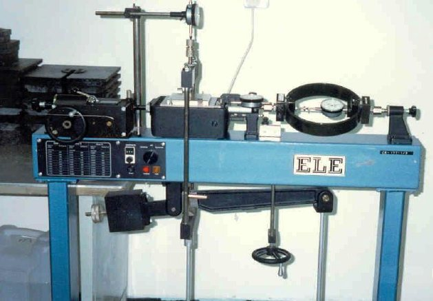
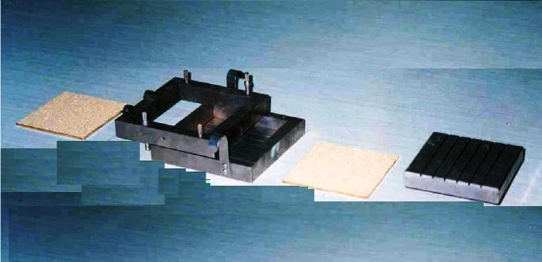
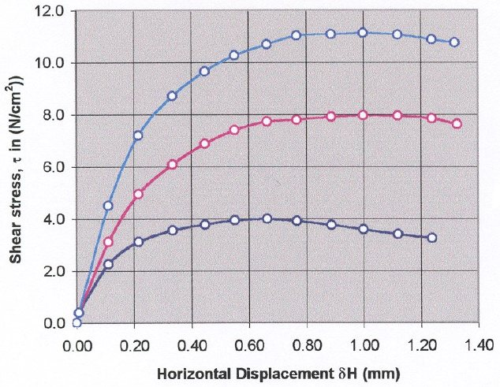
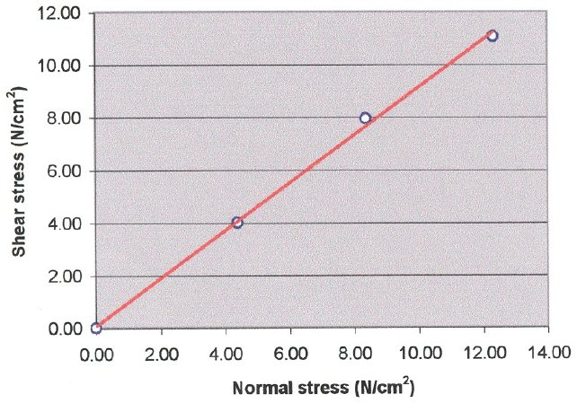

90

# Experiment 7: Direct Shear Test

## Introduction

The Shear strength of a soil is a measure of its resistance to deformation by continuous displacement of its individual soil particles. Soil shear strength is an important consideration in foundation bearing capacity analysis, highway and airfield design and construction, slope stability of earth embankments, and retaining wall construction. Determining the proper strength to use in these types of stability problems can be among the most difficult questions to answer in geotechnical engineering and construction.

## Objective

The direct shear test is commonly used to measure the shear strength parameters of a soil under drained conditions.

## Theoretical Background

The shear strength of a soil is derived from basic components.

• Resistance to displacement because of interlocking of the individual soil particles.

• Resistance to particle translation because of friction between individual soil particles at their common points of contact.

• Cohesion between the surfaces of the soil particles.

Which of these components or combinations of components, are actually effective in resisting shear deformation depends on whether the soil is cohesive or cohesionless and on the soil drainage and consolidation conditions before and during the shear process. Although drainage and consolidation conditions are important considerations

91 in performing a direct shear test, the discussion of these conditions is presented in Triaxial test.

A cohesionless soil is a soil that possesses little or no cohesion. Usually, soils that classify as sands or gravels are considered to be cohesionless. A cohesive soil, on the other hand, is usually a fine-grained soil containing greater percentages of clay particles.

Cohesion is a somewhat nebulous soil property present among clay particles and, perhaps to a much lesser degree, in very fine silts. Several sources of cohesion (more properly called "true cohesion"), cementation, which refers to chemical bonding between particles; (2) electrostatic and electromagnetic attractions. Which include complex electrical double layer and Van der Waals forces interactions, and (3) primary influence bonding and adhesion, which is a concept that address plastic (rather than elastic) “interparticle junctions” and is not very well understood at the present. True cohesion can develop between fine-grained soil particles that have been in stationary "contact" over a long period. It is dependent on the water content and the strain rate as well as the amount of overconsolidation experienced by the soil. It has been shown to be independent of normal stress at low values, but this may not be true at high values of normal stress.

The first hypothesis on soil shear strength was presented by Coulomb in about 1773. Coulomb hypothesized that the shear strength of a soil was dependent on the two components, cohesion and friction τ = c + σn tan φc where, τ = shear strength c = soil cohesion σn = normal stress φc = angle of friction

A direct shear test can be used to determine the shear strength of cohesive as well as cohesionless soils.

92

When choosing which test is to use in determining the values of the shear strength parameters φ and c, consideration of the various advantages and disadvantages of the direct shear test with respect to the other test methods is usually worthwhile. The direct shear test has two distinct advantages with respect to the triaxial test:

1. It is a relatively simple test to conduct and the equipment is also relatively simple to operate.

2. It is a relatively rapid test to complete. However, there are at least three disadvantages:

a) The sample is forced to shear on a specified plane which may not be its weakest plane.

b) The cross-sectional area of the shear plane is constantly changing as the test progresses. This is not such a disadvantage when using a rectangular shear box because the shape of shear plane remains a rectangle, but it becomes a difficult problem when using a circular shear box because, as the test progresses, the shape of the shear plane is that of an area bounded by two intersecting circular arcs.

c) The stress condition across the shear plane are complex, particularly so if using a circular shear box, as the sample is being confined against movement in some areas while movement is permitted in other areas. The assumption of uniform stresses may not always be a good assumption.

## Required Apparatus

1. Direct shear machine with proving ring and appropriate dial gage (Figure 7.1).

2. Direct shear box and shear box cart (Figure 7.2).

3. Porous stones.

4. Loading devices.

5. Balance of sensitive 0.01 g.

93

6. Tow dial indicators one for measuring vertical deformation of the specimen, the other for horizontal displacement of the specimen.

Figure 7.1. Direct Shear Machine

Figure 7.2. Direct Shear Box

## Required Measurements

1. Dimensions of shear box.

2. Weight of empty shear box Wsh.

94

3. Weight of shear box and soil specimen.

4. Proving ring constant, PRC.

5. Elapsed time since start of test, ti.

6. Proving ring reading at time ti.

7. Vertical dial gage reading at time ti.

8. Horizontal dial gage reading at time ti.

## Procedure

Prior to performing the test, make certain that the direct shear machine is level and that the apparatus which applies the normal force to the sample is counterbalanced so that its weight is not also applied to the sample; if the apparatus cannot be so adjusted, the weight of the loading apparatus must be determined and included in the applied load.

1. Assemble the Shear Train

1.a) Place the upper half of the shear box on the lower half. Make sure that all the inscribed codes match.

1.b) Place the two alignment pins in their proper holes to hold the two shear box halves in place while the specimen is being inserted.

1.c) Turn the separation screws counterclockwise until they no longer extend beyond the base of the upper shear box half (usually no more than 3 or 4 complete revolutions with a set wrench).

1.d) (If the bottom half of the shear box is welded to the shear box cart, skip to step 1.e). Place the assembled shear box in the shear box cart, making certain that it is pointed in the correct direction.

1.e) Place the lower gripper plate (and/or extension) in the shear box with the grippers extending upward. The gripper vanes should be perpendicular to the direction of travel during shear.

95

2. Prepare to Test the Soil Sample

2.a) Carefully measure the dimensions of the shear box in preparation for calculating the specimen volume. Weigh the empty shear box to the nearest 1.0 g and record as Wsb. Carefully place the sand specimen in the shear box until approximately one-third of the shear box volume is filled. Use a wooden or metal rod with a flat end to compact the soil to the desired density. Repeat this filling and compacting operation two more times. When finished, the top of the prepared sample should be flush with the top of the shear box. Weigh the shear box and soil to the nearest 1.0 g. Alternatively, weighing the total soil sample before and the soil remaining after building the test specimen provides the sample weight. Predetermining the sample moisture content will permit the sample dry weight to be calculated.

2.b) Carefully place the upper gripper plate/losing cap on the leveled soil specimen. (Gripper vanes are oriented perpendicular to the direction of travel during shear). Depending on the shear apparatus, the loading ball may be placed on the upper gripper plate/loading cap at this step or after the load cart has been installed on the apparatus (step 2.e).

2.c) Move all dial gages out of the way and make sure that no weights are on the loading frame.

2.d) While one person holds the loading frame or yoke out of the way, a second person carefully places the load cart in its proper place. Three (or four) metal studs on the shear apparatus fit into holes on the underside of the load cart and all the studs must be in their proper hole before the load cart has been properly seated.

2.e) Once the load cart has been placed on the direct shear apparatus, place the loading ball on the upper gripper plate (if applicable) and carefully lower the loading frame or yoke into its place.

96

2.f) Check to make sure that the gripper plate is still level. Also check to make sure that the loading frame is centered on the gripper plate and that it is not applying any load to the specimen before any weights have been placed on it.

2.g) Position a dial gage on the top of the loading frame or yoke to measure the vertical displacement of the specimen. Similarly, position a dial gage to measure the horizontal displacement of the upper shear box half.

2.h) Advance the load screw until the dial gage on the proving ring just begins to move. Immediately stop the screw advancement and then back-off the load screw just slightly.

2.i) Advance the separation screws in the upper shear box half clockwise until they just tough the lower half. Then advance each of them an additional amount to separate the shear box halves and create the shear plane. (The amount of separation should be just slightly larger than the largest soil particle).

2.j) Zero all gages and prepare to begin the test.

2.k) Carefully remove the shear pins from the shear box. (Place the shear pins in the load cart after removal so that they will not be misplaced).

2.l) Carefully place the required weights on the weight hanger. (Do not drop the weights onto the hanger). Be careful that the free-hanging hanger and loading frame or yoke do not swing or rotate after the weights have been added.

2.m) Immediately (or as soon as possible) turn on the motor to start the advancement of the load screw. Record dial gage readings in the manner specified by your instructor. (Note: The proving air dial gage should begin moving almost immediately after the motor is turned on. If it is not moving, check to make sure that the motor was engaged in the forward gear. If the indicator on the proving ring makes more than three rapid revolutions in the first 60 to 90 seconds of the test, check to make sure that the shear pins were removed. If the shear pins were removed, stop the test and call your instructor).

2.n) Continue the test to its completion as directed by your lab instructor.

97

3. Remove the Sample after Failure

3.a) When failure has occurred and the last measurement recorded, stop the motor and reverse the load screw. (Check the transmission box before changing directions for instructions). Continue to withdraw the load screw until the load cart can be removed.

3.b) While the load screw is withdrawing, move the dial gages out of the way to prevent damage when the load cart is removed. Also, remove the weights from the hanger.

3.c) When the load screw has withdrawn sufficiently, one person should hold the loading frame or yoke out of the way while a second person removes the load cart.

3.d) Remove the sample in the most convenient manner, being careful to not lose the shear pins or damage the shear box, shear box cart, or either gripper plate. If any difficulty in removing the lower gripper plate is encountered, seek assistance from your instructor.

3.e) Using compressed air and stiff bristle brushes, clean all pieces and reassemble the shear box apparatus for the next trial.

Repeat the test at least two more times to provide at least three points on the τ versus δn plot.

## Calculations

Although numerous calculations of an iterative nature must be accomplished, only six basic equations must be solved:

1. Normal displacement, δv

δv = (dial gage reading, in division) × (units per division)

2. Horizontal displacement δH

98 δH = (dial gage reading, in division) × (units per division)

3. Corrected cross-sectional area, Ac

Ac = W (L − δH) where, W = width of shear box

L = length of shear box (measured in direction of travel)

4. Shear or displacement force, F

F = (proving ring reading, in divisions) × (proving ring constant)

5. Shear stress, τ τ = F/Ac

6. Normal stress, τn τn = N/Ac where, N is the normal force.

The volume of solids, Vs, can be calculated from Vs = Ws/(γw Gs) The initial void ratio, e0, is given by e0 =Vv/Vs = (V0− Vs)/Vs where, V0 is the initial volume.

99

Similar calculations can be made for each data point ei =(Vi − Vs)/Vs where, ei = void ratio at data point i

Vi = volume of the sample at point i, where volume is calculated as

Vi = Ac (D0 + δv) where, D0 = initial sample depth or thickness δv = vertical displacement of sample at point i

## Presentation of Results

The results of the direct shear test can be presented on the data sheet Table 7.1. The shear stress is plotted versus the horizontal deformation. Also the volume change versus the horizontal deformation is plotted. To determine the strength envelope the maximum shear stress is plotted as a function of the normal stress. From the strength envelope the value of angle of friction φ can be determined.

## Numerical Example

Uniform sand was tested in direct shear. Nominal normal pressure of 44, 88 and 120 kPa, respectively, were applied to the specimens in each of three trials. A square shear box of dimensions 10 cm × 10 cm was used in the test. Typical calculations for the third line of the 436.54 N data sheet shown in Table 7.1 are:

δH = (11.2 div) × 0.01 mm/div = 0.112 mm Ac = 10 cm × (10 cm – 0.0112 cm) = 99.888 cm2 F = 150.4 div × 1.5 N/div = 225.6 N T = F/Ac = 225.6 N / 99.888 cm2 = 2.259 N/cm2 σn = N/Ac = 436.51 N / 99.888 cm2 = 4.37 N/cm2

100

| Soil Mechanics Laboratory | DIRECT SHEAR TEST |
|---|---|
| Civil Engineering Department | Data Sheet 7.1 |

Kuwait University

| Name: Numerical Example | Date: …………… |
|---|---|
| Description of Soil: Sandy Soil | Group No. ……… |

Table 7.1

| Shear box 100 mm × 100 mm | Load ring constant = 1.5 N/div | Weight load frame = 4.5 kg |
|---|---|---|
| Wt. of dry specimen = 395 gm | Hz. dial constant = 0.01 mm/div | Load on pan = 4 kg |
| Thickness of specimen = 20 mm | Vl. dial constant = 0.02 mm/div | Lever arm ratio = 1:10 |
| Dry density of soil specimen = ? | Loading ratio = 0.75 mm/min | Initial void ratio of soil = ? |

| Hz. dial reading | Hz. disp. mm | Vl. dial reading | Vl. disp. mm | Corrected area | Load ring reading | Shear force (N) | Shear stress (N/cm2) | Normal stress (N/cm2) |
|---|---|---|---|---|---|---|---|---|
| 0.0 | 0.000 | 0.0 | 0.000 | 100.00 | 0.00 | 0.00 | 0.000 | 4.365 |
| 0.8 | 0.008 | 0.8 | 0.016 | 99.992 | 25.60 | 38.40 | 0.384 | 4.366 |
| 11.2 | 0.112 | −2.4 | −0.048 | 99.888 | 150.40 | 225.60 | 2.259 | 4.370 |
| 21.6 | 0.216 | −12.8 | −0.256 | 99.784 | 206.40 | 309.60 | 3.103 | 4.375 |
| 33.6 | 0.336 | −28.0 | −0.560 | 99.664 | 235.20 | 352.80 | 3.540 | 4.380 |
| 44.8 | 0.448 | −44.8 | −0.896 | 99.552 | 249.60 | 374.40 | 3.761 | 4.385 |
| 55.2 | 0.552 | −64.0 | −1.280 | 99.448 | 260.80 | 391.20 | 3.934 | 4.390 |
| 66.4 | 0.664 | −83.2 | −1.664 | 99.336 | 264.00 | 396.00 | 3.986 | 4.395 |
| 76.8 | 0.768 | −106.4 | −2.128 | 99.232 | 257.60 | 386.40 | 3.894 | 4.399 |
| 88.8 | 0.888 | −129.6 | −2.592 | 99.112 | 248.00 | 372.00 | 3.753 | 4.405 |
| 100.0 | 1.000 | −151.2 | −3.024 | 99.000 | 235.50 | 353.25 | 3.568 | 4.410 |
| 112.0 | 1.120 | −168.8 | −3.376 | 98.880 | 224.00 | 336.00 | 3.398 | 4.415 |
| 124.0 | 1.240 | −199.2 | −3.984 | 98.760 | 212.80 | 319.20 | 3.232 | 4.420 |
| 135.2 | 1.352 | −209.6 | −4.192 | 98.648 | 206.40 | 309.60 | 3.138 | 4.425 |

101

Table 7.2. Typical Ranges of Values of the Angle of Internal Friction

| Dense, Well-graded, coarse sand | 37° − 60° |
|---|---|
| Dense, uniform, fine sand | 33° − 45° |
| Loose, dry sand | 28° − 34° |
| Loose silt or silty sand | 20° − 22° |
| Dense silt or silty sand | 25° − 30° |

Figure 7.3. Shear Stress versus Horizontal Displacement

102

Figure 7.4. Plotting the Maximum Shear Stress as a Function of the Normal Stress

## References

ASTM D-3080-90 Standard Test Method for Direct Shear.

AASHTO T-236-90 Standard Test Method for Direct Shear.

## Questions

1. What is the purpose of a direct shear test ? Which soil properties does it measure ?

2. Why do we use mounting pins in a direct shear test ? Can you predict what will happen if you don’t remove them during the test ?

103

| Soil Mechanics Laboratory | DIRECT SHEAR TEST |
|---|---|
| Civil Engineering Department | Data Sheet 7.1 |

Kuwait University

| Name: ……………………………. | Date: …………… |
|---|---|
| Description of Soil: ……………… | Group No. ……… |

Table 7.1

| Shear box | Load ring constant | Weight load frame |
|---|---|---|
| Wt. of dry specimen | Hz. dial constant | Load on pan |
| Thickness of specimen | Vl. dial constant | Lever arm ratio |
| Dry density of soil specimen | Loading ratio | Initial void ratio of soil |

| Hz. dial reading (div.) | Hz. disp. mm | Vl. dial reading | Vl. disp. mm | Corrected area | Load ring reading (div.) | Shear force (N) | Shear stress (N/cm2) | Normal stress (N/cm2) |
|---|---|---|---|---|---|---|---|---|
|  |  |  |  |  |  |  |  |  |
|  |  |  |  |  |  |  |  |  |
|  |  |  |  |  |  |  |  |  |
|  |  |  |  |  |  |  |  |  |
|  |  |  |  |  |  |  |  |  |
|  |  |  |  |  |  |  |  |  |
|  |  |  |  |  |  |  |  |  |
|  |  |  |  |  |  |  |  |  |
|  |  |  |  |  |  |  |  |  |
|  |  |  |  |  |  |  |  |  |
|  |  |  |  |  |  |  |  |  |
|  |  |  |  |  |  |  |  |  |
|  |  |  |  |  |  |  |  |  |
|  |  |  |  |  |  |  |  |  |
|  |  |  |  |  |  |  |  |  |
|  |  |  |  |  |  |  |  |  |
