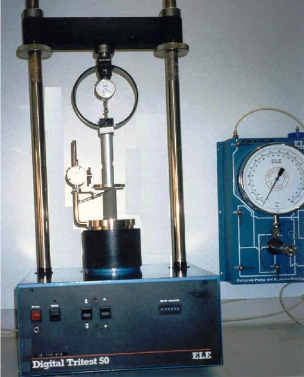
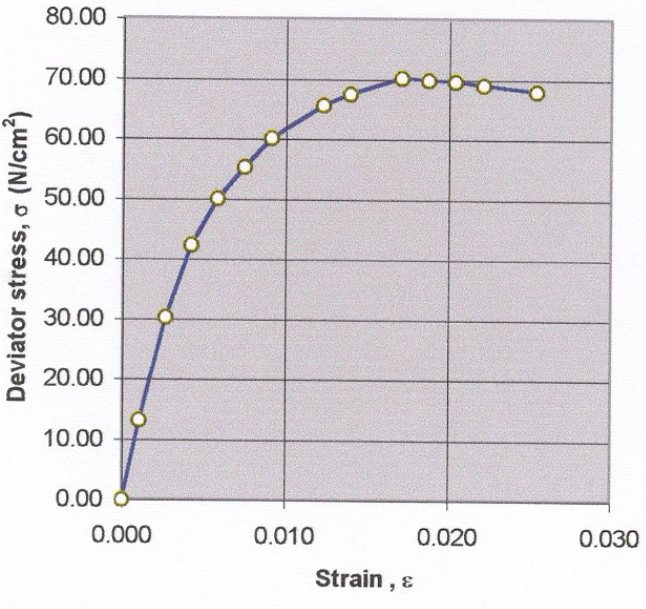

104

# Experiment 8: Unconfined Compression Test

## Introduction

The unconfined compression test is a simple method of measuring the shear strength of saturated cohesive soils. It is a special form of triaxial test. It is used when the soil to be tested is a saturated clay and φ = 0° conditions are determined to govern the design or field conditions.

## Objective

To determine the shear strength of cohesive soil.

## Theoretical Background

When a saturated soil is subjected to an increase in the stress condition, the pore water will carry this increase in stress as excess pore water pressure. For this increase in applied stress to be transferred to the soil skeleton, the excess pore water pressure must first be dissipated. This dissipation process and its rate depends on the permeability of the soil. Since clay soils typically have low permeability, saturated clays can be considered to satisfy the conditions of an unconsolidated undrained (UU) test, which will be presented later, during the period immediately following the application of the load. This situation can be considered to represent the short-term condition.

Thus, the unconfined compression test is considered a form of triaxial test in which the major principal stress is equal to the applied axial stress and the minor principal stress is equal to zero.

The unconfined compressive strength, qu, is defined as the maximum compressive stress at failure. The undrained shear strength, Su, is equal to one-half the unconfined compressive strength.

105

## Required Apparatus

1. Unconfined compression device (electrically driven strain-controlled device is recommended). Figure 8.1.

2. Specimen trimmer (if undisturbed sample is tested).

3. Remolding device (if remolded sample is tested).

4. Dial gage for measuring axial deformation.

5. Caliper for measuring specimen dimensions.

6. Timer.

7. Balance, sensitive to 0.01 g.

Figure 8.1. Unconfined Compression Test

106

## Required Measurements

1. Diameter specimen, D0

2. Length of specimen, L

3. Initial moisture content, wi

4. Final moisture content, wf

5. Total specimen weight before testing, Wi

6. Total specimen weight after test, Wf

7. Vertical deformation gage reading at time, ti

8. Proving ring reading at time, ti

## Sample Preparation

The specimen length should be of a dimension such that the specimen length to diameter ratio is not less than 2 to avoid interference of potential 45° failure planes, and should not be greater than 2.5 to avoid “column” failure.

1. Undisturbed Sample

1.a) Tube samples of 30 mm or 70 mm inner diameter can be tested directly. The ends are trimmed so they are parallel to the loading platen and perpendicular to the longitudinal axis of the specimen.

1.b) If the specimen to be tested must be trimmed out of a larger diameter sample, the trimming should be done in a humid room to avoid evaporation as the specimen is prepared. The trimming process should produce a specimen that has the shape of a right circular cylinder. The ends must be trimmed so that they are parallel to the loading platen and perpendicular to the longitudinal axis of the specimen.

107

1.c) Use the soil trimmings to determine the initial soil moisture content wi.

1.d) Measure the length and diameter of the specimen to the nearest 0.1 mm. Determine the average initial diameter, D0, from the measurement of diameters at the top, Dt, the center, Dc, and the bottom Db of the specimen, such that: D0 =(Dt + Dc + Db)/3 1.e) Weigh the specimen to the nearest 0.01 g, Wi.

2. Remolded Sample

2.a) Compact the soil in a mold of the proper diameter.

2.b) Trim the ends so that they will be horizontal to the loading platen and perpendicular to the longitudinal axis of the specimen.

2.c) Follow the same procedures as for undisturbed sample steps, c, d, and e.

## Procedure

1. Place the specimen in the loading device so that it is centered on the lower platen. Lower the loading cap until it just touches the top of the specimen. Ensure that the specimen is parallel to the line of action of the applied load so that an axial load is applied during testing.

2. Zero the dial gage indicator and the proving ring dial gage.

3. Set the loading rate (strain rate) so that the specimen is strained at a rate of 0.5 to 2 percent per minute. Initiate the loading of the specimen and record proving ring and deformation gage reading at a specified time interval (e.g., 10, 15, 20 or 30 seconds). The strain rate should be set such that the specimen will have failed within 15 minutes. Some specimens will develop a visible failure plane. For this type of failure the proving ring readings will first increase then peak at relatively constant values for a few readings and subsequently begin to diminish.

108

Other specimen will not develop a definite failure plane, and the specimen will only bulge at the middle. For this type of failure, continue to load the specimen until a maximum of 15% strain is reached. Failure is considered to have occurred by the time a strain of this amount is reached.

4. Weight the failed specimen to the nearest 0.01 g and record as Wf.

5. Place the failed specimen in the oven and determine the final moisture content wf.

## Calculations

1. Change in sample length, ΔL

ΔL = dial reading in divisions × units per divisions.

2. Axial strain, ε ε = ΔL/L

3. Corrected cross-sectional area of sample, A0 A0 = A0/(1 − ε) where, A0 = π/4 D02

4. Applied load, P

P = proving ring reading in divisions × proving ring constant

5. Deviator stress, Δσ Δσ = P/A0

109

## Presentation of Results

The applied compressive stress is plotted as a function of the axial strain to obtain the  
axial stress strain relationships. The unconfined compressive strength, qu, of the  
specimen is determined (as the peak stress or the stress at 15% strain, as described  
earlier). The undrained shear strength, su (or cohesion, cu) of soil is obtained from  
Mohr’s circle as qu/2.

## Numerical Example

An undisturbed clay sample was recovered from below the ground water table and  
tested in unconfined compression. The complete test data are shown in Data Sheet  
8.1. Calculations for line 4 of the test data sheet are as follows:

1. Average specimen diameter, D0  
D0 = (3.9 + 3.8 + 4.0) / 3 = 3.8 cm  
2. Average specimen length, L0  
L0 = (8.25 + 8.2 + 8.15) / 3 = 8.2 cm  
3. Specimen initial cross-sectional area, A0  
A0 = π × (3.8)2/4 = 11.34 cm2

4. Applied compressive load, P  
P = 99.96 × 4.82 = 481.807 N

5. Specimen deformation, ΔL  
ΔL = 34.44 × 0.01 = 0.344 mm

6. Axial strain, ε  
ε = ΔL/L0 = 0.344 mm / 82 mm = 0.004 mm

110

7. Corrected cross-sectional area, Ac Ac = A0 / (1 − ε) = 11.34 / (1 – 0.004) = 11.385 cm2

8. Deviator stress, Δσ Δσ = P/Ac = 481.807 / 11.385 = 42.317 N/cm2

Figure 8.2. Deviator Stress versus Axial Strain

111

| Soil Mechanics Laboratory | UNCONFINED COMPRESSION |
|---|---|
| Civil Engineering Department | Data Sheet 8.1 |

Kuwait University

| Name: Numerical Example | Date: ………………… |
|---|---|
| Description of Soil: Sandy Soil | Group No.: …………… |

Deform. Dial Gage Constant = 0.01 mm/div Proving Ring Constant = 4.82 N/div

| Determination of Water Content |  |  | Initial Data |  |
|---|---|---|---|---|
|  | Before Test | After Test |  |  |
| Can number |  |  | Average height, H0 | 8.2 |
| Wt. wet soil + can |  |  | Average diameter, D0 | 3.8 |
| Wt. dry soil + can |  |  | Cross sectional area, A0 | 11.34 |
| Wt. of can |  |  | Volume = A0 × H0 = V0 | 92.988 |
| Wt. of water |  |  | Volume of solid = Ws/Gs = Vs |  |
| Wt. of dry soil |  |  | Void ratio = (V0 – Vs) / Vs = e0 |  |
| Water content |  |  | Saturation = (W0 Gs) / e0 = S0 |  |
| Specific gravity, Gs |  |  | Dry unit weight = Ws / V0 = γd |  |

| Deform Dial red. | Load dial red. | Axial def. ΔH | Axial strain ε=ΔH/H | Area correc. (1 - ε) | Correct area A = (A0/1-ε) | Axial load P | Axial stress P/A |
|---|---|---|---|---|---|---|---|
| 0.00 | 0.00 | 0.00 | 0.000 | 1.00 | 11.34 | 0.00 | 0.00 |
| 8.40 | 31.10 | 0.08 | 0.001 | 1.00 | 11.35 | 149.90 | 13.21 |
| 21.84 | 71.40 | 0.22 | 0.003 | 1.00 | 11.37 | 344.15 | 30.27 |
| 34.44 | 99.90 | 0.34 | 0.004 | 1.00 | 11.39 | 481.52 | 42.28 |
| 47.88 | 118.44 | 0.48 | 0.006 | 0.99 | 11.41 | 570.88 | 50.05 |
| 61.32 | 131.04 | 0.61 | 0.007 | 0.99 | 11.43 | 631.61 | 55.28 |
| 74.76 | 142.80 | 0.75 | 0.009 | 0.99 | 11.44 | 688.30 | 60.14 |
| 100.80 | 156.24 | 1.01 | 0.012 | 0.99 | 11.48 | 753.08 | 65.59 |
| 114.24 | 160.94 | 1.14 | 0.014 | 0.99 | 11.50 | 775.75 | 67.46 |
| 140.20 | 168.00 | 1.40 | 0.017 | 0.98 | 11.54 | 809.76 | 70.19 |
| 153.70 | 167.50 | 1.54 | 0.019 | 0.98 | 11.56 | 807.35 | 69.86 |
| 167.20 | 167.00 | 1.67 | 0.020 | 0.98 | 11.58 | 804.94 | 69.54 |
| 181.44 | 166.00 | 1.81 | 0.022 | 0.98 | 11.60 | 800.12 | 69.00 |
| 208.32 | 165.80 | 2.08 | 0.025 | 0.97 | 11.64 | 799.16 | 68.68 |

112

## References

ASTM D-2166 Standard Test Method for Unconfined Compressive Strength for Cohesive Soil. Measuring Engineering Properties of Soil, Wray, K.W., Prentice Hall, Inc.

## Questions

1. What is the purpose of the unconfined compression test ?

2. To which types of soil is the unconfined test applicable ?

3. What are undisturbed and remolded samples ?

4. What method can you use to prepare undisturbed samples ?

113

| Soil Mechanics Laboratory | UNCONFINED COMPRESSION TEST |
|---|---|
| Civil Engineering Department | Data Sheet 8.1 |

Kuwait University

| Name: ……………………………. | Date: ………………… |
|---|---|
| Description of Soil: ……………… | Group No.: …………… |

| Determination of Water Content |  |  | Initial Data |  |
|---|---|---|---|---|
|  | Before Test | After Test | Average height Ho (mm) |  |
| Can No. |  |  | Average diameter, Do (mm) |  |
| Weight of wet soil + can |  |  | Cross section area, Ao (mm2) |  |
| Weight of dry soil + can |  |  | Volume, Vo = Ho × Ao (mm3) |  |
| Weight of can |  |  | Volume of solid, Vs = Ws/Gs |  |
| Weight of water |  |  | Void ratio, eo = (Vo-Vs)/Vs |  |
| Weight of dry soil |  |  | Degree of saturation, So=wc×Gs/eo |  |
| Water content |  |  | Dry unit weight, γ = Ws/Vo |  |

| Deformation disp. (div.) | Load ring reading (div.) | Axial def. (mm) | Strain (ε) | Corrected area (cm2) | Axial load (N) | Axial stress (N/mm2) |
|---|---|---|---|---|---|---|
|  |  |  |  |  |  |  |
|  |  |  |  |  |  |  |
|  |  |  |  |  |  |  |
|  |  |  |  |  |  |  |
|  |  |  |  |  |  |  |
|  |  |  |  |  |  |  |
|  |  |  |  |  |  |  |
|  |  |  |  |  |  |  |
|  |  |  |  |  |  |  |
|  |  |  |  |  |  |  |
|  |  |  |  |  |  |  |
|  |  |  |  |  |  |  |
|  |  |  |  |  |  |  |
|  |  |  |  |  |  |  |
|  |  |  |  |  |  |  |
|  |  |  |  |  |  |  |
| Remarks: |  |  |  |  |  |  |
