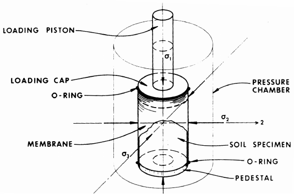
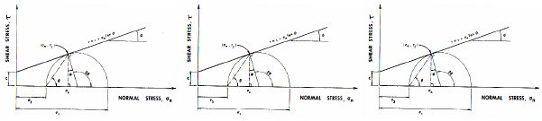
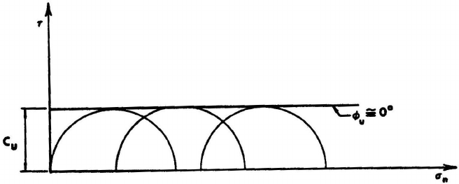
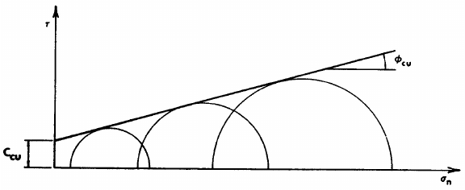
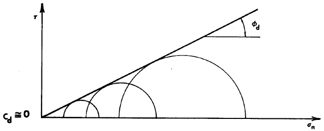
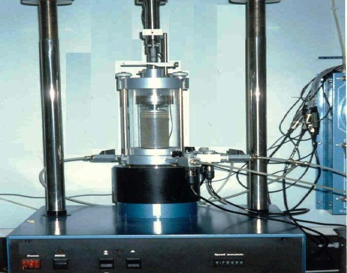
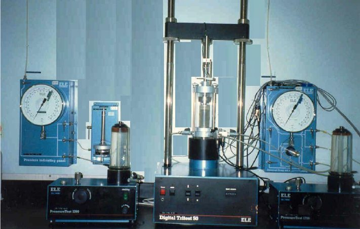
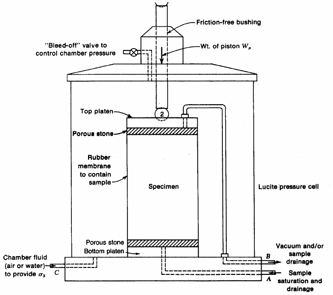
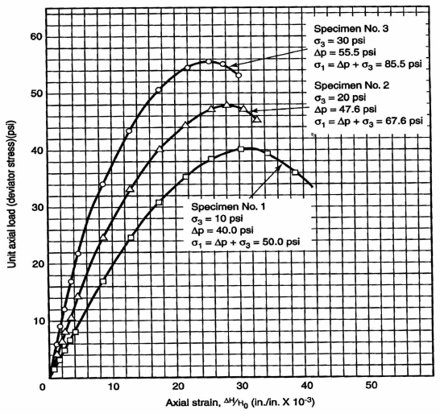
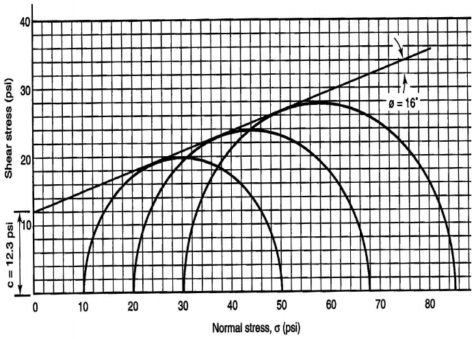

114

# Experiment 9: Triaxial Compression Test

## Introduction

When a soil sample is removed from a soil mass, all of the horizontal and vertical stresses acting on the soil in situ are removed. Thus, when the soil is tested in the laboratory to determine its strength, the test should be conducted under test conditions that resemble the field conditions as closely as possible. The triaxial compression test is a procedure that permits different horizontal and vertical stresses to be applied to the soil specimen simultaneously and thus closely duplicate the expected field conditions.

## Objective

To determine both the undrained and drained shear strength parameters of soils.

## Theoretical Background

The triaxial compression test is called “triaxial” since the soil specimen is subjected to three principal stresses, major principal stress σ1, intermediate principal stress σ2 and minor principal stress, σ3. If the principal axes, as shown in Figure 9.1, are labeled 1, 2 and 3 then the stresses σ2 and σ3 are acting in the two horizontal directions. The concept of the test is that an all-around equal pressure is applied to the soil specimen in the form of a confining pressure σc. This pressure is obtained by imposing a compressive stress on a fluid that completely surrounds the specimen. Since the confining pressure is an all-around pressure, then:

σc = σ1 = σ2 = σ3

Usually, the principal change in stress experienced by a soil mass is a change in vertical stress due to the construction of a building, highway, or any other structure. Consequently, it would be logical to test the soil specimen in a configuration that permits that specimen to be placed in the testing device and loaded in a manner that

115 duplicates what will happen in the field. Thus, most soil specimens are tested in the triaxial test by applying a vertical loading to the specimen.

The vertical load that is being applied to the soil specimen causes it to feel a vertical stress which is larger than the confining pressure. This increase in vertical pressure is called the deviator stress, Δσ. When the deviator stress is being applied, the major principal stress becomes σ1 = σc + Δσ

To simplify calculations, the two horizontal stresses are referred to as σ3, and the maximum value of Δσ is used to calculate the maximum σ1:

Figure 9.1. Soil Specimen Mounted in a Triaxial Cell

(showing principal stresses and components of the apparatus)

The test is repeated at least two more times, each trial at a different confining pressure. Mohr circles are plotted for the three tests on the same axes. A smooth curve of best fit is then drawn so that the curve is tangent to each of the Mohr’s circle (Figure 9.2). This curve represents the coulomb failure envelope. The slope of this curve is the angle of internal friction φ, and its intercept with the vertical shear stress axis, τ, represents the value of the soil cohesion, c. The shear strength is determined as:

S = c + σ tan φ

116

Figure 9.2. Mohr’s Stress Circle

However, the effective angle of internal friction and the corresponding value of soil cohesion are dependent on the loading and drainage conditions in effect during the test. There are three possible loading and drainage condition combinations:

1. Unconsolidated – undrained (UU)

| 2. Consolidated – undrained | (CU) |
|---|---|
| 3. Consolidated – drained | (CD) |

1. UU Test: the test is performed immediately after applying the confining pressure. The failure loading is applied to the sample so rapidly that no pore water can escape or drain from the test specimen during the test. The test produces a value for φ of 0° for saturated cohesive soils. The UU test is often called “quick” test because it can be performed quickly compared to the other two types. It can usually be completed in about 30 minutes per specimen.

2. CU Test: the test is performed after the specimen has consolidated due to the application of the confining pressure. The consolidation stage requires 24 hours to ensure that the consolidation has been completed. The shearing load is then applied rapidly, as in the UU test, so that no drainage occurs during the shearing stage.

117

3. CD Test: the test is performed after the specimen has consolidated due to the application of the confining pressure. The consolidation stage requires 24 hours. The specimen is then loaded to failure at a loading rate that is sufficiently slow that drainage occurs and no excess pore pressure develops. This may require from few hours to several days or, in some instances, even weeks. Thus, the CD test is termed “slow test”.

The choice of which test conditions to use to determine the shear strength parameters is usually dependant on the drainage conditions expected to exist at the project site. If the soil is sandy, excess pore pressures resulting from new loads dissipates rapidly and drained conditions are employed during the test. On the other hand, if the soil is a saturated clay and the load is applied quickly, excess pore pressure dissipates slowly and undrained conditions are employed during the test.

The relative forms of the Mohr circle-failure envelope plots are presented in Figure 9.3. The procedures of performing the CU and CD tests are not discussed in this text. Only the test procedures of the UU test is described.

## Required Apparatus

1. Triaxial compression device.

2. Triaxial cell (including loading piston and pedestal).

3. Rubber membrane.

4. Membrane stretcher.

5. O-rings.

6. Porous stones.

7. Compressed air source.

8. Vacuum and air pressure supply.

9. Specimen trimmer (for cohesive soil).

## Required Measurements

1. Diameter of specimen, D.

118

2. Height of specimen, L.

3. Initial moisture content.

4. Final moisture content.

5. Proving ring reading.

6. Vertical deformation gage reading.

(a) Unconsolidated-Undrained (UU) Test

(b) Consolidated-Undrained (CU) Test

(c) Consolidated-Drained (CD) Test

Figure 9.3. Typical Forms of the Multiple-Trial Mohr’s Circle-Failure Envelope

Plots for the Three Types of Triaxial Test

119

## Sample Preparation (cohesive Soils)

1. Using a mechanical trimmer, carefully trim the soil specimen to the required diameter and length. Determine the initial moisture content.

2. Place an O-ring on the bottom of the loading pedestal and an impervious disk between the pedestal and the specimen to prevent drainage from occurring.

3. Insert a rubber membrane into the membrane stretcher and vacuum is applied to the stretcher. Place the membrane over the specimen after it has been placed on the cell pedestal and the loading cap placed on top. Release the vacuum and roll the membrane over the loading cap on top and the pedestal on the bottom.

4. Remove the membrane stretcher and install the O-rings so that the membrane is tightly sealed between the loading cap and an O-ring on top and between the pedestal and an O-ring on the bottom.

5. Install the loading cap properly and place the triaxial cell over the specimen and securely seal the chamber. (see Figure 9.4).

6. Fill the chamber with the confining fluid (usually water) and pressure the cell (see Figure 9.5 for the setup of triaxial cell).

Figure 9.4. Triaxial Cell

120

Figure 9.5 (a). Setup of Triaxial Test with Pressure Sources

Figure 9.5 (b). Line Details of the Triaxial Cell

121

## Procedures

1. Lower the loading frame until the loading piston is just in contact with the loading cap, making sure that no load is being applied to the specimen.

2. Zero both the strain-measuring dial gage and the proving ring. Make sure that the drainage valve from the soil sample is closed.

3. Start the loading mechanism and at specified intervals (e.g., 10, 15, 20 or 30 seconds) record the dial readings of the strain gage and proving ring gage, while monitoring the cell pressure.

4. Continue until the specimen fails or until the strain exceed 15 percent of the specimen height.

5. After the test is completed stop the loading mechanism and reverse the loading piston, depressurize the cell and drain the fluid from the chamber. Remove the triaxial cell and the specimen. Obtain the final moisture content of the specimen.

6. Repeat the test to obtain at least three trials, each performed at a different confining pressure.

## Calculations

1. Axial strain ε =ΔL/L0 where, ΔL is the change in specimen length,

L0 is the original specimen length.

2. The corrected cross-sectional area, Ac, at any point during the test: Ac =A0/(1− ε) where, A0 is the cross-sectional area of the specimen.

3. Deviator stress, Δσ: Δσ =P/Ac where, P is the applied load and is equal to:

P = (proving ring reading in divisions) × (proving ring constant)

122

## Presentations of Results

The result of the UU-test is reported simply as the value of C. The Mohr’s circle and failure envelope is also included.

## Test Results

For any saturated, cohesive soil, the test results are dependent on the test used: In UU-test: φu ≈ 0 &emsp; and Cu > 0

In CD-test: φd ≈ true value and Cd ≈ 0 In CU-test: φcu < φd &emsp; and Ccu > Cu

Results also depend on whether the soil is normally consolidated, over consolidated, or a remolded sample.

## Numerical Example

An unconsolidated undrained triaxial compression test was performed on a soil specimen in the laboratory according to the procedure described. The following data were obtained:

A. Specimen Data

Diameter of specimen, D0 = 2.50 in. Initial height of specimen, H0 = 5.82 in. Mass of specimen = 920.20 g Water content data: Mass of wet soil plus can = 939.92 g Mass of dry soil plus can = 811.07 g Mass of can = 48.62 g The specific gravity of the soil is known to be 2.78

123

B. Triaxial Compression Data

Chamber pressure on test specimen, σ3 = 10.0 psi Rate of axial strain = 0.02 in/min Proving ring calibration = 6,000 lb/in

| Elapsed Time (min) | Deformation Dial, ΔH (in) | Proving Ring Dial (in) |
|---|---|---|
| 0 11.25 | 0 0.005 0.010 0.015 0.020 0.025 0.050 0.075 0.100 0.125 0.150 0.175 0.200 0.225 | 0 0.0012 0.0025 0.0037 0.0053 0.0066 0.0140 0.0201 0.0256 0.0294 0.0321 0.0337 0.0331 0.0305 |

[It is, of course, necessary to perform triaxial tests on two (preferably, even three or more) specimens from the same sample at different chamber pressures in order to evaluate the shear strength parameters. In this example, however, actual data are shown for only one specimen tested.]

With the preceding data known, necessary computations can be made as follows:

C. Specimen Parameters

The height-to-diameter ratio is 5.82/2.50, or 2.33, which is between 2 and 2.5 and therefore acceptable. The initial area A0 and volume V0 of the specimen are easily computed as follows:

124

A0 =πD02/4=(π (2.50)2)/4 = 4.91 in2 V0 = (H0)(A0) = (5.82)(4.91) = 28.58 in3 with the mass and volume of the specimen known, its wet unit weight γwet can be determined: γwet = (920.20/28.58) ((1,728)/453.6) = 122.7 lb/ft3 (The numbers 1,728 and 453.6 are conversion factors: 1,728 in3 = 1 ft3; 453.6 g = 1 lb).

The water content of the specimen may be computed as follows: w =(939.92 - 811.07)/(811.07 - 48.62)× 100= 16.9 % With water content known, dry unit weight γdry can be determined next: γdry =γwet/(w + 100)× 100 =122.7/(16.9 + 100)× 100 = 105.0 lb/ft3 In order to find the degree of saturation, a single cubic foot of soil specimen may be isolated as follows:

Weight of water in 1 ft3 of soil specimen = γwet - γdry = 122.7 – 105.0 = 17.7 lb Volume of water in 1 ft3 of soil specimen = (weight of water)/(unit weight of water)=17.7/62.4 = 0.284 ft3  Weight of solid in 1 ft3 of soil specimen = γdry = 105.0 lb

Volume of solid in 1 ft3 of soil specimen

125

= (weight of solid)/(specific gravity of solid × 62.4)=105.0/((2.78) (62.4)) = 0.605 ft3 

Volume of void in 1 ft3 of soil specimen = 1 – volume of solid = 1 – 0.605 = 0.395 ft3 Degree of saturation = (volume of water)/(volume of void)× 100 =0.284/0.395× 100 = 71.9 % These data, both given and computed, are shown on the form on page 157. At the end of the chapter, two blank copies of this form are included for the reader’s use.

D. Triaxial Compression

The first deformation dial reading ΔH is 0.005 in. The axial strain ∈ for this particular applied load can be computed using Equation (9.1): ε =ΔH/H0 &emsp; (9.1) ε =0.005/5.82 = 0.0009 The corresponding cross-sectional area of the specimen can be computed using Equation (9.2): A =A0/(1 − ε) &emsp; (9.2)

A =4.91/(1 − 0.0009) = 4.91 in2 Multiplying the proving ring dial reading (0.0012 in) by the proving ring calibration (6,000 lb/in) gives a corresponding applied axial load of 7.2 lb. Finally, dividing the applied axial load (7.2 lb) by the corresponding cross-sectional area (4.91 in2) gives a unit axial load of 1.5 lb/in2 (or psi).

126

The values above fill in the second row of the form on page 158. Similar calculations furnish values for succeeding given deformation dial readings and proving ring dial readings needed to fill in the remaining rows on the form.

It should be emphasized that one or two additional evaluations are required for additional triaxial compression tests on other specimens of the same sample at different chamber pressures. Such evaluations are not included here.

E. Stress-Strain Curve

The required stress-strain curve is obtained by plotting axial strain along the abscissa versus unit axial load along the ordinate. The curve for this example is the lower one in Figure 9.6. As indicated in the figure, the values of σ3 (given), Δp (determined from the curve), and σ1 (Δp + σ3) are 10.0, 40.0, and 50.0 psi, respectively.

Figure 9.6. Unit Axial Load versus Axial Strain Curves

127

It will be noted that two additional stress-strain curves for other triaxial compression tests on different specimens, along with associated values of σ3, Δp, and σ1, are presented in Figure 9.6. Neither the test data not required subsequent calculations for defining these curves are given in this example. They are provided at this point in order to complete the evaluation of the shear strength parameters.

F. Shear Diagram (Mohr Circles for Triaxial Compression)

From results of the triaxial test for which data are given in this example, a point is located along the abscissa at a distance σ3, or 10.0 psi, from the origin (see Figure 9.7). Another point is located along the abscissa at a distance σ1, or 50.0 psi, from the origin. With the straight line connecting these points as a diameter, a semicircle is then constructed as shown in Figure 9.7. By repeating the process for the test for the second specimen (σ3 = 20.0 psi, σ1 = 67.6 psi), points are located along the abscissa at σ3 = 20.0 psi and σ1 = 67.6 psi from the origin, and a semicircle is drawn. Another semicircle is then constructed in the same manner for the test for the third specimen (σ3 = 30.0 psi, σ1 = 85.5 psi).

Figure 9.7. Mohr Circles for Triaxial Compression

128

With the three semicircles thus constructed, a straight line tangent to the semicircles is drawn as shown in Figure 9.7. The angle between this straight line and a horizontal line is measured as 16°, and the value of shear stress where the straight line intersects the ordinate is observed to be 12.3 psi. Hence, the angle of internal friction and the cohesion for this soil are 16° and 12.3 psi, respectively. These values (the shear strength parameters) are the major results of a triaxial compression test.

## References

ASTM D-2850, Standard Test Method for Unconsolidated, Undrained Compressive Strength of Cohesive Soils in Triaxial Compression.

AASHTO T-234, Standard Method of Test for Strength Parameters of Soils by Triaxial Compression.

Engineering Properties of Soils and their Measurements, 4th edition, Joseph E. Bowles, McGraw-Hill, Inc., 1992.

Measuring Engineering Properties of Soil, Wray W.K., Prentice Hall, 1986.

## Questions

1. Which soil properties are determined from CD and CU triaxial test on coarse- grained sand ?

2. Describe briefly the preparation of a sand specimen ?

3. Why do we use a rubber membrane in triaxial tests ?

4. How is saturation checked in triaxial tests ?

5. Why should the sample be saturated in CU and CD tests ?

129

| Soil Mechanics Laboratory UNCONSOLIDATED UNDRAINED (UU) |
|---|
| Civil Engineering Department TRIAXIAL COMPRESSION TEST |
| Kuwait University Data Sheet 9.1 |

| Sample No.: 10 | Project No.: J21 |
|---|---|
| Location: Jabriya | Boring No.: 2 |
| Depth: 10 ft | Date of Test: 6/5/2004 |
| Description of Soil: Brown silty clay | Tested by: George Smith |

A. Specimen Data (Specimen No. 1)

1. Type of test performed unconsolidated-undrained, without pore

pressure measurement.

2. Type of specimen (check one) ☐ Undisturbed ☒ Remolded  
3. Diameter of specimen, D0 2.50 in.  
4. Initial area of specimen, A0 4.91 in2  
5. Initial height of specimen, H0 5.82 in.

6. Height-to-diameter ratio [i.e.,(5)/(3)] 2.33

7. Volume of specimen, V0 [i.e., (4) × (5)] 28.58 in3  
8. Mass of specimen 920.20 g

9. Wet unit weight of specimen [i.e.,(8)/453.6×(1,728)/(7)] 122.7 lb/ft3

10. Water content of specimen 16.9 %  
a) Can number 2-A  
b) Mass of wet soil + can 939.92 g  
c) Mass of dry soil + can 811.07 g  
d) Mass of can 48.62 g  
e) Mass of water [i.e., (b) – (c)] 128.85 g  
f) Mass of dry soil [i.e., © - (d)] 762.45 g

g) Water content [i.e.,(e)/(f)× 100] 16.9 %

11. Dry unit weight of specimen [i.e.,(9)/((10) + 100)× 100] 105.0 lb/ft3

12. Specific gravity of soil 2.78  
13. Weight of water in 1 ft3 of soil specimen [i.e., (9) – (11)] 17.7 lb

14. Volume of water in 1 ft3 of soil specimen [i.e.,(13)/62.4] 0.284 ft3

15. Weight of solid in 1 ft3 of soil specimen [i.e., (11)] 105.0 lb

16. Volume of solid 1 ft3 of soil specimen [i.e.,(15)/((12) × 62.4)] 0.605 ft3

17. Volume of void in 1 ft3 of soil specimen [i.e., 1 – (16)] 0.395 ft3

18. Degree of saturation [i.e.,(14)/(17)× 100] 71.9 %

130

B. Triaxial Compression Data (Specimen No. 1)

1. Chamber pressure on test specimen, σ3 10.0 psi

2. Rate of axial strain 0.02 in/min

3. Initial height of specimen, H0 5.82 in

4. Proving ring calibration 6,000 lb/in

| Elapsed Time (min) | Deformation Dial, ΔH (in) | Axial Strain, ε (in/in) | Cross- Sectional Area, A (in2) | Proving Ring Dial (in) | Applied Axial Load (lb) | Unit Axial Load (Deviator Stress) (psi) |
|---|---|---|---|---|---|---|
| (1) | (2) | (3) ΔH H0 | A0 (4) 1− ε | (5) | (6) = (5) × proving ring calibration | (7) = (6) (4) |
| 0 | 0 | 0 | 4.91 | 0 | 0 | 0 |
|  | 0.005 | 0.0009 | 4.91 | 0.0012 | 7.2 | 1.5 |
|  | 0.010 | 0.0017 | 4.92 | 0.0025 | 15.0 | 3.0 |
|  | 0.015 | 0.0026 | 4.92 | 0.0037 | 22.2 | 4.5 |
|  | 0.020 | 0.0034 | 4.93 | 0.0053 | 31.8 | 6.5 |
|  | 0.025 | 0.0043 | 4.93 | 0.0066 | 39.6 | 8.0 |
|  | 0.050 | 0.0086 | 4.95 | 0.0140 | 84.0 | 17.0 |
|  | 0.075 | 0.0129 | 4.97 | 0.0201 | 120.6 | 24.3 |
|  | 0.100 | 0.0172 | 5.00 | 0.0256 | 153.6 | 30.7 |
|  | 0.125 | 0.0215 | 5.02 | 0.0294 | 176.4 | 35.1 |
|  | 0.150 | 0.0258 | 5.04 | 0.0321 | 192.6 | 38.2 |
|  | 0.175 | 0.0301 | 5.06 | 0.0337 | 202.2 | 40.0 |
|  | 0.200 | 0.0344 | 5.08 | 0.0331 | 198.6 | 39.1 |
| 11.25 | 0.225 | 0.0387 | 5.11 | 0.0305 | 183.0 | 35.8 |

Minor principal stress (i.e., chamber pressure, σ3) 10.0 psi

Unit axial load at failure, Δp 40.0 psi

Major principal stress at failure (i.e., σ1 = σ3 + Δp) 50.0 psi

131

| Soil Mechanics Laboratory | TRIAXIAL COMPRESSION TEST |
|---|---|
| Civil Engineering Department | Data Sheet 9.1 |

Kuwait University

| Name: …………… | Date: …………. | Group No. ………. |
|---|---|---|
| Description of Soil: ………… |  | B.H. # …………… |
| Location: …………………… |  | Depth: …………… |

A. Specimen Data

1. Type of Test performed …………………………………………  
2. Type of Specimen ……………………………………………….  
3. Diameter of Specimen, Do ………………………………………  
4. Initial Area of Specimen, Ao …………………………………….  
5. Initial Height of Specimen, Ho ………………………………….  
6. Height-to-diameter Ratio ………………………………….…….  
7. Volume of Specimen, Vo ………………………………….…….  
8. Mass of Specimen ………………………………….…….……..  
9. Wet Unit Weight of Specimen ………………………………….  
10. Water Content of Specimen …………………………………….  
a) Can No. ………………………………….…….…….…….  
b) Weight of wet soil can ………………………………….…  
c) Weight of dry soil + can ………………………………….  
d) Weight of can ………………………………….…….……  
e) Weight of water ………………………………….…….…  
f) Weight of dry soil ………………………………….…….  
g) Water content ………………………………….…….……  
11. Dry Unit Weight of Specimen ………………………………….  
12. Specific Gravity of Soil ………………………………….…….  
13. Weight of Water in Soil ………………………………….…….  
14. Volume of Water ………………………………….…….……..  
15. weight of Dry Soil ………………………………….…….…….  
16. Volume of Solid ………………………………….…….…….…  
17. Volume of Void ………………………………….…….…….…  
18. Degree of Saturation ………………………………….…….….

132

B. Triaxial Compression Data

1. Chamber pressure on test specimen

2. Rate of axial strain

3. Initial height of specimen, Ho

4. Proving ring constant

| Deformation disp. (div.) | Axial def. (mm) | Strain (ε) | Corrected area (cm2) | Load ring reading (div.) | Axial load (N) | Axial stress (N/mm2) |
|---|---|---|---|---|---|---|
|  |  |  |  |  |  |  |
|  |  |  |  |  |  |  |
|  |  |  |  |  |  |  |
|  |  |  |  |  |  |  |
|  |  |  |  |  |  |  |
|  |  |  |  |  |  |  |
|  |  |  |  |  |  |  |
|  |  |  |  |  |  |  |
|  |  |  |  |  |  |  |
|  |  |  |  |  |  |  |
|  |  |  |  |  |  |  |
|  |  |  |  |  |  |  |
|  |  |  |  |  |  |  |
|  |  |  |  |  |  |  |
